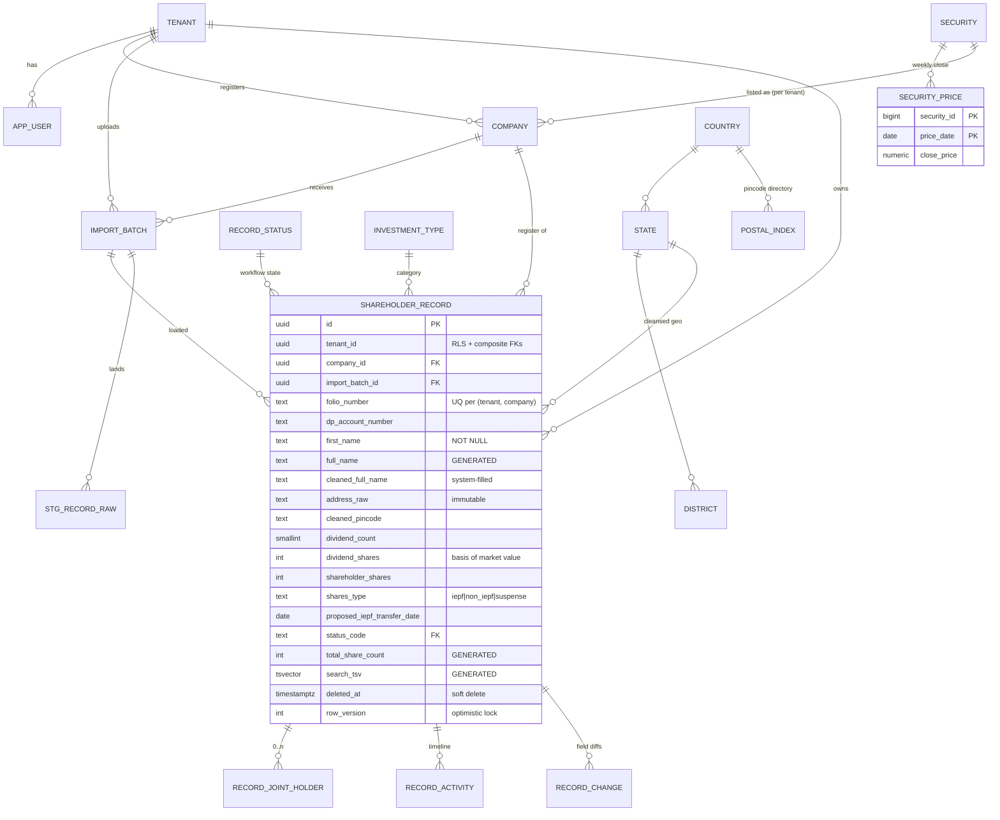

# Enterprise PostgreSQL Database Design — Module 1: Unclaimed Investment / IEPF Shareholder Data

**Prepared:** 25 August 2026 · **Target platform:** PostgreSQL 16+ · **Source:** `Module 1 Sample data Columns.xlsx` (2 sheets, 5,000 sample rows, 61 defined columns)

> Every schema object in this document was executed and smoke-tested against PostgreSQL 16.13: the full DDL ran cleanly, all 5,000 sample rows were loaded through the staging pipeline, RLS isolation was verified with two tenants, and the search indexes were confirmed in query plans. Claims below marked **[observed]** are facts measured programmatically in the workbook; claims marked **[assumption]** are stated design assumptions.

---

## A. Executive Summary

The workbook is the intake-and-tracking template for an **unclaimed investment recovery operation** (IEPF domain, India): lists of shareholders of listed companies (Tata Chemicals, Reliance, Infosys, …) whose dividends/shares are unclaimed or transferred to the Investor Education and Protection Fund, enriched with market valuations and worked through a claim-recovery workflow (data cleansing → calling → KYC → filing → claimed).

The recommended design is deliberately the **simplest architecture that meets all stated requirements**, with explicit evolution points:

1. **Single PostgreSQL cluster, shared schema multi-tenancy** — every tenant-owned table carries `tenant_id` and is protected by **forced Row-Level Security** with fail-closed session context. Composite foreign keys `(tenant_id, id)` make cross-tenant references impossible at the constraint level, not just the policy level.
2. **One core entity** — `app.shareholder_record`, one row per (company, folio/demat account) — surrounded by a small set of supporting entities: `tenant`, `app_user`, `company`, `import_batch`, `record_joint_holder`, `record_activity`. The Excel's 61 columns do **not** become 61 columns: 11 of them are derived values that are never stored (market values, concatenated names, totals, counts, "address available"), 4 are file-level facts normalized into `import_batch`, and repeating groups (joint holders, call/cleaning/validation events) become child tables.
3. **Shared reference layer** (`reference` schema, no tenant_id): geography (country/state/district/pincode directory used for the required auto-fill enrichment), the securities master with **weekly price history** (`security_price` — the "update every Saturday night" feed, fetched once for all tenants), and controlled vocabularies (investment types, record statuses) as lookup tables rather than PostgreSQL enums.
4. **Market value is computed, never stored.** Verified against the sample: the Excel's own `Market Value` column matches `dividend_shares × share_price` in 5,000/5,000 rows; storing it would create a value that silently goes stale every Saturday. A `security_invoker` view derives it from the latest price; a materialized view serves aggregate dashboards.
5. **Search on PostgreSQL alone** — `pg_trgm` GIN indexes for fuzzy/partial name and address search, a generated `tsvector` for multi-token search, tenant-prefixed B-tree indexes for filters (status, state, pincode, dates), and keyset pagination on `(display name, id)`. An external search engine is not justified at this scale and the thresholds that would change that are stated in §G.
6. **Analytics on the same cluster initially** — tenant-filtered materialized views refreshed after the weekly price sync and after imports, with a read replica as the first scaling step and a warehouse only at Phase 3 volumes.
7. **Auditability as a first-class requirement** — `created/updated/deleted _at/_by` + `row_version` (optimistic locking) on mutable business tables, an append-only field-level diff log (`audit.record_change`) on the core entity, an append-only operational timeline (`record_activity`) replacing the single-value "Date of Calling / remarks" columns, and immutable raw source fields preserved alongside cleansed values.
8. **PII is treated seriously**: names, addresses, DOB, PAN are PII; **Aadhaar is never stored in clear** (application-layer encryption + last-4 only), PAN is format-checked and access-restricted, and role separation (`app_rw`, `app_ro`, `svc_import`, `svc_price_loader`, `platform_admin`) enforces least privilege.

**Most important decisions at a glance**

| Decision | Choice | Main alternative rejected | Why |
|---|---|---|---|
| Tenancy | Shared schema + `tenant_id` + forced RLS | Schema-per-tenant | Thousands of tenants operable with one migration path; RLS + composite FKs give provable isolation |
| Core grain | One row per (company, folio/demat) | One row per investor person | No reliable person identifier in data (PAN 0% populated); identity resolution is a downstream feature |
| Market value | Derived via price history | Stored column | Verified derivable 100%; stored copy goes stale weekly; history explains past valuations |
| Dropdowns | Lookup/reference tables | PostgreSQL enums | MCA vocabularies grow; labels are user-facing; no `ALTER TYPE` migrations in hot paths |
| Search | PostgreSQL (`pg_trgm` + FTS) | OpenSearch | Sufficient below ~50M rows / moderate QPS; thresholds documented |
| Partitioning | None now; design is partition-ready | Partition day one | 5K sample rows; concrete triggers defined (§J) |

---

## B. Excel Data Analysis

### B.1 Workbook structure

| Sheet | Purpose | Shape |
|---|---|---|
| `Sample Data` | 5,000 example records, headers in row 2, columns B–AM (38 business columns) | The intake file as prepared by the analysis ("BI") team |
| `Column Details` | The template contract: 61 columns (A–BI) with requirement notes (row 7), compulsory/optional/system-filled flags (row 12), and cell formats (row 13) | Defines the full lifecycle — 23 columns beyond the intake file cover cleansing, validation, calling, and status tracking |

The `Column Details` sheet is the more complete specification: it shows the intake columns **plus** the downstream workflow columns (`Updated *` cleansed fields, `Status of Shares`, IEPF/Non-IEPF/Suspense share buckets, joint holders, `Date of Calling`, validation remarks, `Updated Market Value`). The database must model the full lifecycle, not just the intake file.

### B.2 Business purpose and entity identification

Each row is an **unclaimed holding record**: a shareholder of a listed company identified by folio number (physical holdings) or DP/Client ID (demat), with the number of shares whose dividends are unclaimed, a classification (IEPF / Non IEPF / Suspense), a market valuation, and a recovery-workflow status. The likely operator is a recovery/claims service processing many companies' registers — 9 companies appear in the sample **[observed]**.

### B.3 Column-by-column findings (facts measured across all 5,000 rows)

**Identifiers and keys**

- `Unique Code` (e.g. `TCL0000000TC001`): **[observed]** in 5,000/5,000 rows it is exactly `3-letter company prefix + zero padding + folio number`, 16 chars. It is a *derived* duplicate-detection key, not an independent fact. The template also specifies a separate "System generated code … don't make this code by using any column" — i.e. a true surrogate key. → Surrogate UUID primary key; the natural key becomes a **unique constraint on (tenant, company, folio)**; the legacy code is retained as `record_code` for reconciliation.
- `Folio Number`: **[observed]** unique per company (0 duplicates); template says "system should check duplication of folio no by individual company". Alphanumeric → `text`.
- `DP Id-Client Id-Account Number`: 0% populated in the sample but defined ("normally start with 16 digit"). Physical vs demat holdings → **at least one of folio/DP must be present** (CHECK constraint).
- `Folio/Demat No`: **[observed]** always identical to `Folio Number` where DP is empty — a coalesce, i.e. **derived → generated column**, not entered data.
- `Sr No`: **[observed]** contiguous 1–5,000 — a physical file row number. Belongs in staging (`source_row_number`) for error reporting, **not** in the business table.

**Names**

- `Investor Full Name` and `Father Full Name`: **[observed]** exact whitespace-normalized concatenations of their three parts in 5,000/5,000 rows (the template even includes the `TRIM(CONCAT(...))` formula) → **derived → generated columns**.
- `Father Full Name` contains **1,624 empty strings vs NULL** in the remainder **[observed]** — an empty-string/NULL inconsistency the schema resolves (`NULLIF` on load, generated column emits NULL).
- First name is compulsory ("no data accepted if this column is blank") → `NOT NULL` + non-blank CHECK. Middle/last/father parts optional; template warns of junk tokens (`0`, `#N/A`, `Not available`) — none present in this sample **[observed]**, but the cleansing rules stay in the pipeline.
- All names are ALL-CAPS register text; the template's `Updated *` columns apply `PROPER(TRIM(...))` → separate `cleaned_full_name` / `cleaned_father_husband_name` columns, system-filled, with the raw parts preserved.

**Address and geography**

- `Address` is a single free-text blob (max 169 chars observed). **[observed]** 4,785/5,000 values carry leading/trailing whitespace; 94 contain letter-O-for-zero corruption in embedded pincodes ("BOMBAY 4OOO56"); many embed the pincode/city that also appear in dedicated columns.
- `Country` 100% populated (14 values); `State` 99% (only Indian rows); `District` **0% populated** but required by the template's enrichment rules ("blank details automatically filled by system as per pincode"); `Pin Code` 100% but **[observed]** all 49 non-India rows carry the sentinel `999999` — a fake value that must become NULL on load.
- `Pin Code` arrived as a number — safe for Indian PINs (never start with 0) but wrong as a general type (foreign postal codes, leading zeros) → `text`.
- → Raw address block preserved verbatim (`address_raw`, `country_raw`, …) + cleansed block (`cleaned_address`, `locality`, `cleaned_pincode`) + FKs into a shared geo reference (`country`/`state`/`district`/`postal_index`) that powers the required pincode auto-fill.

**Holdings, dividends, valuation**

- `Dividend Count No`: integers 1–7 **[observed]** — number of unclaimed dividend distributions. `smallint`.
- `Final No Shares (Dividend)` vs `Final No of Shares (Shareholder)`: equal in 4,953/5,000 rows, different in 47 **[observed]** — two distinct facts; both kept.
- `Shares Type`: exactly `{IEPF, Non IEPF}` in the sample; template adds `Suspense`. **[observed]** perfectly correlated with dividend count (6–7 → IEPF), matching the batch remark "IEPF Count taken as 6 & 7". It is a classification *decided at preparation time* under a rule that can change → stored, CHECK-constrained.
- `Share Price`: **[observed]** a single value (747) for all 9 companies — clearly placeholder data. The template requirement is the real design driver: *"will link to latest share price of NSE/BSE, and system will update the price every Saturday night"* → a shared **price history table**, one feed for all tenants.
- `Market Value`: **[observed]** equals `Final No Shares (Dividend) × Share Price` in **5,000/5,000** rows — while the written definition says "(Shareholder) × price" (matches only 4,953). A contradiction between spec and data, and the strongest argument for **not storing it**: derive it from one authoritative formula (flagged as an open question, §Q).
- `Updated Market Value` = `Total no of shares × price` per the template → also derived.
- `IEPF`/`Non IEPF`/`Suspense` share counts (user-verified breakdown) + `Total No of shares` = "sum of the above" → three stored columns + a **generated** total.

**Dates, flags, workflow**

- `Proposed Date of transfer to IEPF`: 7 distinct dates 2018–2024 **[observed]**, September each year (matching IEPF's 7-year rule cadence). `date`.
- `Date of Preparation` and `Remarks (From BI)`: **[observed]** single value repeated on all 5,000 rows — **file-level facts → `import_batch`**, not per-row columns.
- `Address Available (Yes/No)`: **[observed]** constant "Yes"; fully derivable from the address column → **not stored** (derived in the read view).
- Litigation / unpaid-suspense flags: defined Yes/No, 0% populated → nullable `boolean` (NULL = not yet assessed).
- `Status of Shares`: 7-value dropdown ("if shares are claimed all further columns should be blank") → lookup table + status-change history; a terminal-state flag models the "claimed" rule.
- `Date of Calling`, `Data Cleaning Remarks`, `Data Validation Remarks`: single-value columns that in reality are **repeating events** (a record is called more than once) → append-only `record_activity` table.
- `Joint Holder 1`, `Joint Holder 2`, `Count of Joint Holder`: a classic repeating group capped at 2 by the spreadsheet → child table `record_joint_holder`; the count is derived.

**PII (0% populated in the sample but defined in the template):** `PAN`, `Date of Birth`, `Aadhar Number`, `Nominee Name`. See §K.3 — Aadhaar gets special treatment (never stored in clear).

### B.4 Columns that must NOT be stored as entered

| Excel column | Why not stored | Replacement |
|---|---|---|
| Unique Code | Derived from company prefix + folio | UNIQUE (tenant, company, folio); legacy value kept as `record_code` for reconciliation |
| Investor Full Name, Father Full Name | Exact concatenations (verified 100%) | `GENERATED ALWAYS AS … STORED` |
| Folio/Demat No | Coalesce of two columns | Generated column |
| Address Available | Derivable from address | Derived in read view |
| Market Value, Updated Market Value | Shares × latest price; goes stale weekly | `app.v_record_valuation` view + analytics MV |
| Total No of shares | Sum of three buckets | Generated column |
| Count of Joint Holder | COUNT of child rows | Derived in read view |
| Sr No | File row position | `staging.source_row_number` only |
| Date of Preparation, BI Remarks | File-level, repeated 5,000× | `import_batch.prepared_on`, `.analysis_remarks` |
| Share Price | A property of the security on a date, not of the record | `reference.security_price` history |
---

## C. Entity Model

### C.1 Entities and why they exist

| Entity | Kind | Business concept |
|---|---|---|
| `app.tenant` | Core | A client organization of the platform. Root of all isolation. |
| `app.app_user` | Supporting | People and per-tenant service accounts; the target of every `*_by` audit column. |
| `app.company` | Core | A tenant's registration of a listed company they process (their label + short code); links to the shared security master. |
| `reference.security` | Reference | The listed security itself (ISIN, NSE/BSE symbols) — a public fact, shared by all tenants. |
| `reference.security_price` | Reference (time series) | Weekly close-price history; the Saturday-night sync target; the source of every market value. |
| `app.import_batch` | Transactional | One uploaded file: preparation date, dividend window, analysis remarks, row counts, idempotency hash. |
| `app.shareholder_record` | **Core (the grain)** | One unclaimed holding: (company, folio/demat) with holder identity, address, holding facts, workflow status. |
| `app.record_joint_holder` | Child | Joint holders (repeating group, 0..n per record). |
| `app.record_activity` | Transactional (append-only) | Calls, cleansing runs, validation notes, status changes — the operational timeline. |
| `reference.country/state/district/postal_index` | Reference | Government geo lists; `postal_index` drives pincode → state/district/locality auto-fill. |
| `reference.investment_type`, `reference.record_status` | Lookup | MCA investment categories; workflow status vocabulary. |
| `staging.shareholder_record_raw` | Staging | All-text landing zone for imports; carries validation outcomes. |
| `audit.record_change` | Audit | Field-level diff history of the core entity. |

**Relationships and cardinality**

- tenant 1—N app_user, company, import_batch, shareholder_record (all tenant-owned tables).
- company 1—N import_batch 1—N shareholder_record (a record belongs to exactly one company; batch membership is kept for lineage).
- reference.security 1—N reference.security_price (composite PK `(security_id, price_date)`); security 0..1—N app.company *per tenant* (partial unique) — many tenants may register the same security (the deliberate cross-tenant sharing point).
- shareholder_record 1—N record_joint_holder (unique `(record_id, position)`), 1—N record_activity, 1—N audit.record_change.
- Geography: country 1—N state 1—N district 1—N postal_index rows; cleansed record columns FK to each level independently (a record may have a country but no resolvable state).
- No many-to-many relationships exist in this domain yet. A future `investor_master` (identity resolution across companies — the business goal behind "Unique Code … to find duplicates") would introduce one: investor N—M record via a match table. Deliberately **not** built now: with PAN/DOB/Aadhaar 0% populated there is no reliable match key, and guessing identities in the schema would corrupt the grain (§Q).
- One-to-one: the cleansed address block stays **on** the record rather than in a 1:1 table — it is read on every search hit, and a join would buy nothing but latency.

### C.2 ERD



*(Market value intentionally absent from every table: it lives in `app.v_record_valuation` = shares × latest `SECURITY_PRICE`.)*

### C.3 Key strategy

Surrogate keys everywhere a row is referenced across the system: `uuid` (via `gen_random_uuid()`) for tenant-owned business entities — safe to expose in URLs/APIs, mergeable across environments, no sequence contention across tenants; `bigint identity` for high-volume append-only children (`record_activity`, `record_joint_holder`, audit) where compactness matters and IDs are internal; `smallint/bigint identity` for reference rows. Natural keys are retained as **unique constraints**, never as PKs: `(tenant_id, company_id, upper(folio_number))`, `(tenant_id, short_code)`, `(country_id, name)`, `(security_id, price_date)`, ISIN. Composite `(tenant_id, id)` unique constraints exist solely as targets for tenant-safe composite FKs (§E.3).

---

## D. Table-by-Table Design

Notation: **Key** — PK / FK / UQ (unique) / cUQ (composite/partial unique). Audit columns (§F) are shown once per table but not re-explained. All `app.*` tables: RLS forced, policy `tenant_id = app.current_tenant_id()`.

### D.1 `app.tenant` — client organizations

The isolation root. `settings jsonb` holds tenant-specific configuration (feature flags, formatting preferences) — a justified jsonb use: schemaless by nature, never filtered on relationally.

| Column | PostgreSQL Type | Null | Key | Default | Description | Index |
|---|---|---|---|---|---|---|
| id | uuid | NN | PK | gen_random_uuid() | Tenant surrogate id | PK |
| name | text | NN | | | Legal/display name | — |
| slug | text | NN | UQ | | URL-safe identifier, CHECK format | UQ |
| status | text | NN | | 'active' | CHECK: active/suspended/offboarding/deleted | — |
| settings | jsonb | NN | | '{}' | Tenant configuration | — |
| created_at / updated_at | timestamptz | NN | | now() | | — |

### D.2 `app.app_user` — identities per tenant

Referenced by every `*_by` column. `user_type='service'` rows are the per-tenant system accounts that own automated writes (imports, price-driven refreshes, geo enrichment) — so audit columns never need to be NULL for "the system did it".

| Column | PostgreSQL Type | Null | Key | Default | Description | Index |
|---|---|---|---|---|---|---|
| id | uuid | NN | PK | gen_random_uuid() | | PK |
| tenant_id | uuid | NN | FK→tenant | | | in UQ |
| email | text | NN | cUQ | | CHECK email format; unique per tenant, case-insensitive | uq (tenant_id, lower(email)) |
| display_name | text | NN | | | | — |
| user_type | text | NN | | 'human' | CHECK: human/service | — |
| is_active | boolean | NN | | true | | — |
| created_at / updated_at | timestamptz | NN | | now() | | — |

### D.3 `reference.security` and `reference.security_price` — shared market data

The one deliberately shared dataset: prices are public facts fetched once (Saturday-night job) for all tenants. Append-only history — a valuation shown in March is explainable in June.

`reference.security`

| Column | PostgreSQL Type | Null | Key | Default | Description | Index |
|---|---|---|---|---|---|---|
| id | bigint identity | NN | PK | | | PK |
| legal_name | text | NN | | | Canonical listed name | — |
| isin | char(12) | Y | UQ | | CHECK ISIN format | UQ |
| nse_symbol / bse_code | text | Y | | | Exchange identifiers for the price feed | — |
| is_active | boolean | NN | | true | | — |

`reference.security_price`

| Column | PostgreSQL Type | Null | Key | Default | Description | Index |
|---|---|---|---|---|---|---|
| security_id | bigint | NN | PK, FK→security | | | PK(1) |
| price_date | date | NN | PK | | Pricing date (weekly) | PK(2) |
| close_price | numeric(12,2) | NN | | | CHECK > 0. `numeric`, never float — money | — |
| source | text | NN | | 'NSE' | CHECK: NSE/BSE/MANUAL | — |

`reference.latest_security_price` (view): `DISTINCT ON (security_id) … ORDER BY price_date DESC` — index-backed by the PK.

### D.4 `app.company` — a tenant's company registration

| Column | PostgreSQL Type | Null | Key | Default | Description | Index |
|---|---|---|---|---|---|---|
| id | uuid | NN | PK | gen_random_uuid() | | PK |
| tenant_id | uuid | NN | FK→tenant; UQ(tenant_id,id) | | Composite-FK target | UQ |
| security_id | bigint | Y | FK→reference.security | | NULL until mapped; market value needs it | cUQ (tenant_id, security_id) partial |
| display_name | text | NN | cUQ | | Tenant's label ("BPCL Ltd") | uq (tenant_id, display_name) |
| short_code | text | NN | cUQ | | Prefix for legacy record codes, CHECK `^[A-Z0-9]{2,6}$` | uq (tenant_id, short_code) |
| is_active | boolean | NN | | true | | — |
| audit set | | | | | created/updated _at/_by, row_version | — |

### D.5 `app.import_batch` — one uploaded file

| Column | PostgreSQL Type | Null | Key | Default | Description | Index |
|---|---|---|---|---|---|---|
| id | uuid | NN | PK | gen_random_uuid() | | PK |
| tenant_id | uuid | NN | FK; UQ(tenant_id,id) | | | UQ |
| company_id | uuid | NN | cFK→company(tenant_id,id) | | Tenant-safe composite FK | ix (tenant_id, company_id) |
| source_file_name | text | NN | | | | — |
| source_file_sha256 | text | Y | cUQ | | **Idempotent imports**: same file → conflict, not duplicates | uq partial |
| prepared_on | date | NN | | | Excel "Date of Preparation" | — |
| dividend_year_from / _to | smallint | Y | | | Parsed dividend window ("Div 2018 to 2024"); CHECK from ≤ to | — |
| analysis_remarks | text | Y | | | Excel "Remarks (From BI)" | — |
| status | text | NN | | 'received' | CHECK: received/validating/loaded/failed/archived | — |
| total_rows / loaded_rows / rejected_rows | integer | Y | | | Reconciliation counters | — |
| audit set | | | | | created/updated _at/_by, row_version | — |

### D.6 `app.shareholder_record` — THE core table

One row per unclaimed holding per company. Raw register fields are immutable evidence; `cleaned_*` fields are system-enriched; generated columns handle every verified derivation.

| Column | PostgreSQL Type | Null | Key | Default | Description | Index |
|---|---|---|---|---|---|---|
| id | uuid | NN | PK | gen_random_uuid() | The "system generated code" of the template | PK |
| tenant_id | uuid | NN | FK→tenant; UQ(tenant_id,id) | | RLS + composite-FK anchor | in all composites |
| company_id | uuid | NN | cFK→company(tenant_id,id) | | Cannot point at another tenant's company | leading in uq folio |
| import_batch_id | uuid | Y | cFK→import_batch(tenant_id,id) | | Lineage | ix (tenant_id, import_batch_id) |
| record_code | text | Y | cUQ | | Legacy "Unique Code", minted at import | uq (tenant_id, record_code) partial |
| folio_number | text | Y | cUQ | | | **uq (tenant_id, company_id, upper(folio_number)) WHERE folio IS NOT NULL AND deleted_at IS NULL** |
| dp_account_number | text | Y | cUQ | | Demat account | same pattern |
| folio_or_demat | text | — | | GENERATED | COALESCE(folio, dp) — Excel col Y | — |
| investment_type_id | smallint | NN | FK→reference.investment_type | | MCA category | — (12-row lookup) |
| first_name | text | NN | | | CHECK non-blank ("no data accepted if blank") | — |
| middle_name / last_name | text | Y | | | | — |
| full_name | text | — | | GENERATED | TRIM/squash concat — verified 100% derivable | trgm via COALESCE expr |
| father_husband_ first/middle/last _name | text | Y | | | | — |
| father_husband_full_name | text | — | | GENERATED (NULLIF → real NULLs) | Fixes the 1,624 empty-string rows | in tsvector |
| cleaned_full_name | text | Y | | | System PROPER(TRIM()) + corrections | trgm + sort expr |
| cleaned_father_husband_name | text | Y | | | | — |
| date_of_birth | date | Y | | | CHECK ≥ 1875-01-01. PII | — |
| pan | text | Y | | | CHECK `^[A-Z]{5}[0-9]{4}[A-Z]$`. PII | — (see §Q: index only if lookup-by-PAN becomes a feature) |
| aadhaar_last4 | text | Y | | | CHECK 4 digits. Display/matching only | — |
| aadhaar_encrypted | bytea | Y | | | App-layer encrypted; never clear text | — |
| nominee_name | text | Y | | | PII | — |
| address_raw / country_raw / state_raw / district_raw / pincode_raw | text | Y | | | Verbatim source — immutable evidence | — (never indexed) |
| cleaned_address | text | Y | | | System-normalized | trgm via COALESCE expr |
| locality | text | Y | | | Auto-filled from pincode directory | — |
| cleaned_pincode | text | Y | | | `text` (leading zeros, foreign codes); CHECK format | ix (tenant_id, cleaned_pincode) partial |
| country_id / state_id / district_id | smallint/smallint/integer | Y | FK→reference geo | | Enriched, validated geography | ix (tenant_id, state_id) partial |
| geo_enriched_at | timestamptz | Y | | | Excel "Date of cleaning" (geo pass) | — |
| dividend_count | smallint | NN | | | CHECK 0–200 | — |
| dividend_shares | integer | NN | | | CHECK ≥ 0. Market-value basis (verified) | — |
| shareholder_shares | integer | NN | | | CHECK ≥ 0 | — |
| shares_type | text | NN | | | CHECK: iepf/non_iepf/suspense | in composite w/ status if needed |
| proposed_iepf_transfer_date | date | Y | | | Deadline-driven outreach filter | ix (tenant_id, date) partial |
| under_litigation | boolean | Y | | | NULL = not assessed | — |
| from_unpaid_suspense | boolean | Y | | | NULL = not assessed | — |
| source_remarks | text | Y | | | Row-level remarks from source | — |
| status_code | text | NN | FK→reference.record_status | 'NOT_STARTED' | Workflow state | ix (tenant_id, company_id, status_code); ix (tenant_id, status_code) |
| status_changed_at / status_changed_by | timestamptz / uuid | Y | FK→app_user | | Last transition (history in record_activity) | — |
| iepf_share_count / non_iepf_share_count / suspense_share_count | integer | Y | | | User-verified breakdown; CHECK ≥ 0; NULL until verified | — |
| total_share_count | integer | — | | GENERATED sum | NULL until all three present (null-propagating on purpose) | — |
| search_tsv | tsvector | — | | GENERATED | names + father + address + identifiers | GIN |
| created_at/by, updated_at/by, deleted_at/by | audit set | | FK→app_user | | Soft delete pair CHECK | partial indexes exclude deleted |
| row_version | integer | NN | | 1 | Optimistic locking (trigger-bumped) | — |

### D.7 `app.record_joint_holder`

| Column | PostgreSQL Type | Null | Key | Default | Description | Index |
|---|---|---|---|---|---|---|
| id | bigint identity | NN | PK | | | PK |
| tenant_id | uuid | NN | | | RLS | — |
| record_id | uuid | NN | cFK→record(tenant_id,id) ON DELETE CASCADE | | | in UQ |
| holder_position | smallint | NN | cUQ | | CHECK 1–10; UQ (record_id, position) | UQ |
| full_name | text | NN | | | CHECK non-blank | — |
| created_at / created_by | | | | | | — |

### D.8 `app.record_activity` — append-only operational timeline

UPDATE/DELETE revoked from all application roles. `details jsonb` carries per-type payload (e.g. `{"old_status": "...", "new_status": "..."}`) — justified jsonb: heterogeneous by activity type, never filtered relationally.

| Column | PostgreSQL Type | Null | Key | Default | Description | Index |
|---|---|---|---|---|---|---|
| id | bigint identity | NN | PK | | | PK |
| tenant_id | uuid | NN | | | RLS | in ix |
| record_id | uuid | NN | cFK ON DELETE CASCADE | | | ix (record_id, occurred_at DESC) |
| activity_type | text | NN | | | CHECK: call/data_cleaning/validation/status_change/note | ix (tenant_id, type, occurred_at DESC) |
| occurred_at | timestamptz | NN | | now() | Excel "Date of Calling" et al. | in ixs |
| remarks | text | Y | | | Cleaning/validation/call remarks | — |
| details | jsonb | Y | | | Type-specific payload | — |
| performed_by | uuid | Y | FK→app_user | | | — |

### D.9 `reference` geo + lookups, `staging`, `audit`

- `reference.country` (id, iso2 UQ, name UQ) · `reference.state` (id, country_id FK, name; UQ(country_id, name)) · `reference.district` (id, state_id FK, name; UQ(state_id,name)) · `reference.postal_index` (country_id, pincode, locality, state_id, district_id; UQ(country_id, pincode, COALESCE(locality,'')); ix(pincode)) — loaded from government lists per the template requirement; drives auto-fill.
- `reference.investment_type` (id, code UQ, label UQ) — seeded with the observed value + standard MCA/IEPF categories.
- `reference.record_status` (code PK, label UQ, sort_order, is_terminal) — the "Status of Shares" dropdown + `NOT_STARTED` **[assumption — flagged]**; `is_terminal=true` on CLAIMED supports the "all further columns blank once claimed" rule at the application layer.
- `staging.shareholder_record_raw` — every template column as `text`, plus `import_batch_id`, `source_row_number` (UQ per batch), `is_valid`, `validation_errors jsonb`, `target_record_id`, `loaded_at`. Nothing constrained beyond identity — its job is to accept dirty data.
- `audit.record_change` (id, tenant_id, table_name, record_pk, operation U/D, changed_at, changed_by, changed_columns text[], old_values jsonb, new_values jsonb) — trigger-fed diff log; ix (record_pk, changed_at DESC), ix (tenant_id, changed_at DESC). `text[]` here is a justified array: a list of column names, never joined against.

### D.10 Read-model views

- `app.v_record_valuation` (**security_invoker**): record → company → latest price; emits `market_value` (= dividend_shares × price, the formula the sample actually follows) and `updated_market_value` (= COALESCE(total_share_count, shareholder_shares) × price).
- `app.v_record_current` (**security_invoker**): the API read shape — display name/address (cleaned-else-raw), derived `address_available`, joint-holder count, last-call timestamp, valuation columns, status label.
- `analytics.v_company_portfolio`, `analytics.v_geo_distribution`: tenant-filtering windows over the MVs (§H).
---

## E. Tenant Architecture

### E.1 Options evaluated

| Model | Verdict | Reasoning |
|---|---|---|
| **Shared database, shared schema + `tenant_id` + RLS** | **Recommended** | One migration path, one connection pool, one backup/monitoring surface; scales to thousands of tenants; PostgreSQL RLS makes isolation a database guarantee rather than an application habit; cross-tenant analytics for the operator stay possible under a controlled role. |
| Schema-per-tenant | Rejected | N× migration executions, catalog bloat at hundreds of schemas, connection-pool fragmentation, painful cross-tenant ops. Justified only when tenants demand bespoke schema variations — not the case here (one uniform template). |
| Database-per-tenant | Rejected (now) | Strongest isolation, but operationally heavy (per-DB backups/replicas/upgrades). Kept as the **escape hatch for a regulated mega-tenant**: because every table already carries `tenant_id`, extracting one tenant into a dedicated database is a filtered dump — the design keeps this door open. |
| Hybrid | Not yet | Becomes relevant in Phase 3 (§P): shared schema for the many, dedicated databases for the few giants. |

### E.2 Where `tenant_id` lives — and where it must not

- **Has `tenant_id` + RLS:** every `app.*` table, `staging.shareholder_record_raw`, `audit.record_change`. Child tables (`record_joint_holder`, `record_activity`) carry it too — denormalized on purpose so RLS never depends on a join and their indexes can be tenant-prefixed.
- **Must NOT have `tenant_id`:** everything in `reference` (geo, securities, prices, vocabularies). Duplicating public reference data per tenant would multiply the price feed by the tenant count and create drift. This is the explicitly identified "not duplicated" boundary.

### E.3 Isolation that cannot be bypassed accidentally

Three independent layers, tested in the smoke run:

1. **Forced RLS** on every tenant table (`FORCE ROW LEVEL SECURITY` — even the table owner is subject). Policy: `tenant_id = app.current_tenant_id()`, both `USING` and `WITH CHECK`. The context function returns NULL when unset → **zero rows, fail closed** (verified: no context ⇒ 0 visible; wrong tenant ⇒ 0 visible; cross-tenant INSERT ⇒ policy violation error).
2. **Tenant-aware composite foreign keys**: `shareholder_record (tenant_id, company_id) → company (tenant_id, id)` and likewise for batch and record children. Even a bug running as a privileged role cannot attach a record to another tenant's company — the FK itself fails.
3. **Tenant-prefixed unique constraints and indexes**: uniqueness is always scoped `(tenant_id, …)` — one tenant's folio numbering can never collide with another's, and every hot index is tenant-leading so a tenant's working set is a contiguous index range.

**Context handling:** the application sets `SELECT set_config('app.current_tenant', $1, true)` (transaction-scoped, third argument `true`) at the start of every transaction — never connection-scoped, because pooled connections are reused across tenants (PgBouncer transaction mode). The user context (`app.current_user_id`) rides the same mechanism for audit attribution.

**Cross-tenant operations:** platform support/ops use `platform_admin` (`BYPASSRLS`), a break-glass role with audited access, never the application role. Cross-tenant aggregate reporting for the operator runs on the replica under that role.

**Tenant lifecycle:** offboarding = `tenant.status='offboarding'` (application blocks logins) → export → hard purge by `tenant_id` in child-first FK order (activity/joint holders cascade from records), then reference data is untouched. Because every table carries `tenant_id`, purge and export are single-predicate operations. **Tenant-specific configuration** lives in `tenant.settings jsonb`; per-tenant vocabulary extensions, if ever needed, would be a `tenant_id`-scoped overlay table — not edits to `reference`.

**Large-tenant scalability:** tenant-leading indexes mean a huge tenant degrades itself before it degrades neighbors for index-driven access; Phase 2/3 adds partitioning by `hash(tenant_id)` or extraction of the giant to its own database (§J, §P).

---

## F. Audit Strategy

| Field | Where | Why / where not |
|---|---|---|
| `created_at`/`created_by`, `updated_at`/`updated_by` | `company`, `import_batch`, `shareholder_record` (+ created-only on append-only children) | Mutable business tables. Not on `reference.*` rows loaded by pipelines (curated data, changes ship as migrations) beyond `created_at`, and not `updated_*` on append-only tables — they are never updated. |
| `deleted_at`/`deleted_by` | `shareholder_record` only | The only entity users "remove" but the business must retain (evidence, reconciliation, restore). Pair-consistency CHECK `(deleted_at IS NULL) = (deleted_by IS NULL)`. Companies/batches deactivate (`is_active`, `status='archived'`), they don't delete. No `is_deleted` boolean — `deleted_at IS NULL` is one predicate, and a second flag can only disagree with it. |
| `row_version` | The three mutable tables | Optimistic locking: `UPDATE … WHERE id=$1 AND row_version=$2`; trigger bumps it. Concurrent edit → 0 rows → 409 to the client. |
| Timestamps | **Database-generated** (`DEFAULT now()`, trigger for `updated_at`) | One clock; app servers drift. |
| `*_by` identity | **Application-supplied** `uuid → app.app_user(id)` | The DB knows the pooled service login, not the human. FK to `app_user`; automated writes use the per-tenant `user_type='service'` account — never NULL "because the system did it". |
| Immutable records | `record_activity`, `audit.record_change`, `staging` rows, `security_price`, raw `*_raw` columns | Enforced by revoked UPDATE/DELETE grants, not conventions. |
| History | `audit.record_change` — field-level diff (changed columns, old/new jsonb) on UPDATE/DELETE of the core entity, via trigger; INSERTs are *not* logged (creation is fully described by the row + its batch). `record_activity` holds the *business* timeline (calls, cleansing, validation, status changes) — deliberately separate from the *technical* diff log: users read one, auditors read the other. | |

Trigger cost: one extra row write per core-entity update — acceptable at this workload (updates are human-driven: status changes, cleansing passes). Bulk system updates (e.g. re-enrichment) can temporarily `ALTER TABLE … DISABLE TRIGGER tg_shareholder_record_audit` inside a maintenance window with a batch-level audit entry instead — documented, not default.

Temporal/event sourcing: **not introduced.** Requirements need "who changed what when" (diff log) and "what happened operationally" (activity log) — full bitemporal tables or event sourcing would add heavy complexity with no consumer. Effective-dating exists only where the domain has it naturally: the price history.

---

## G. Search Architecture

### G.1 What gets searched (inferred from data + template)

| Access pattern | Mechanism | Index |
|---|---|---|
| Fuzzy / partial name ("desai", "INDUMATI DES", misspellings) | `pg_trgm` similarity / ILIKE '%…%' | GIN trgm on `COALESCE(cleaned_full_name, full_name)` (partial: live rows) |
| Multi-token search across name + father + address + folio ("DESAI BOMBAY") | FTS | GIN on generated `search_tsv` (`simple` config — proper nouns; no stemming language fits Indian names) |
| Address contains | trgm | GIN trgm on `COALESCE(cleaned_address, address_raw)` |
| Exact folio / demat / record code | case-insensitive unique lookup | the `upper()` unique indexes double as lookup indexes |
| Facet: company + status (the workflow queue) | B-tree | `(tenant_id, company_id, status_code)` partial |
| Facet: status across companies | B-tree | `(tenant_id, status_code)` partial |
| Geography: state, pincode | B-tree | `(tenant_id, state_id)`, `(tenant_id, cleaned_pincode)` partial |
| IEPF deadline windows | B-tree range | `(tenant_id, proposed_iepf_transfer_date)` partial |
| Value-sorted lists ("largest recoveries first") | precomputed | analytics MV (value = shares × weekly price; changes once a week — no point computing per query) |
| Default browse + keyset pagination | B-tree | `(tenant_id, COALESCE(cleaned_full_name, full_name), id)` partial |

Every index above is justified by a named query, tenant-leading (equality on `tenant_id` makes composite order optimal: equality columns first, then selective filter/sort columns), and partial on `deleted_at IS NULL` where applicable so deleted rows cost nothing. Selectivity notes: `status_code` is low-cardinality but *skewed* (queues query the small active statuses — partial index still pays); trgm GIN indexes are the expensive ones (~30–50% of column size, slower writes) and are confined to the two text columns users actually search. Verified in plans: trgm similarity → Bitmap Index Scan on the GIN; tsquery → Bitmap Index Scan on `search_tsv`.

**Case-insensitivity** is handled by expression indexes (`upper(folio_number)`) and trgm (inherently case-insensitive via ILIKE/similarity) — no `citext` dependency.

### G.2 When PostgreSQL stops being enough

PostgreSQL **is sufficient** for this workload now and for a long time: single-tenant working sets in the millions, search = name/identifier/facet lookup, no relevance-ranking product requirements. Move name/address search (only) to OpenSearch/Elasticsearch when any of these hold: (a) > ~50–100M live records with heavy concurrent fuzzy search causing GIN maintenance pain (index bloat on churn, slow REINDEX windows); (b) product needs relevance tuning, synonyms, phonetic matching (Indian-name transliteration variants: "Shah/Sha", "Chaudhuri/Choudhary") beyond trgm's edit-distance-ish behavior; (c) search QPS grows independent of transactional load and deserves its own scaling axis. Sync via logical replication/CDC into the engine; PostgreSQL remains the source of truth.

---

## H. Analytics Architecture

The workloads are dashboard-shaped: portfolio value per company, status funnels, geographic distribution, deadline pipelines, batch reconciliation — aggregations over at most tens of millions of rows, refreshed at most weekly (valuations change Saturday night) or per import.

**Recommendation: stay on the OLTP cluster, isolate by object and by replica — no warehouse yet.**

1. **Materialized views** (`analytics.company_portfolio_mv`, `analytics.geo_distribution_mv`) precompute the expensive joins (records × latest price). Refreshed `CONCURRENTLY` (unique indexes present) by the Saturday price job and after batch loads — analytics reads never scan the hot table at request time. MVs do not honor RLS, so raw MVs carry **no grants**; tenants reach them only through `analytics.v_*` views that filter on `app.current_tenant_id()` (verified: other tenant sees 0 rows).
2. **Read replica (Phase 2)**: point reporting/exports and the operator's cross-tenant analysis at a hot-standby. Zero schema work — the design needs nothing changed.
3. **Warehouse (Phase 3)**: when history depth (monthly valuation snapshots × years), cross-source joins, or scan volumes outgrow the replica — CDC (logical replication / Debezium) into a columnar store (BigQuery/Snowflake/ClickHouse). The dimensional model is already latent in this schema: fact = shareholder_record (+ a valuation snapshot fact keyed by price_date), dimensions = company/security, status, geography, investment type, date, tenant. Star-schema conversion is mechanical because the OLTP model normalized those dimensions from day one.
4. **Valuation time series**: if "portfolio value over time" becomes a product feature, add an incremental weekly snapshot table (`analytics.portfolio_valuation_weekly`, appended by the price job) rather than recomputing history — noted as the first analytics evolution, not built now.

OLTP↔OLAP separation summary: same schema, separate objects (MVs), separate refresh windows, then separate hardware (replica), then separate engine (warehouse) — each step justified by measured pain, never speculative.

---

## I. Index Strategy (consolidated)

**`app.shareholder_record`** — the only table where indexing is a real budget (write cost: each secondary index adds ~1 write amplification per insert/update of indexed columns; GIN worst).

| # | Index | Type | Supports | Cost note |
|---|---|---|---|---|
| 1 | PK (id) | B-tree | Point lookup, FKs from children | — |
| 2 | UQ (tenant_id, id) | B-tree | Composite-FK target | Cheap, uuid pair |
| 3 | uq (tenant_id, company_id, upper(folio_number)) partial | B-tree | Natural-key integrity + exact folio search + FK-side join to company | Dual-purpose: constraint *and* the company-scoped browse index |
| 4 | uq (tenant_id, company_id, upper(dp_account_number)) partial | B-tree | Demat lookups | Tiny while column sparse (partial) |
| 5 | uq (tenant_id, record_code) partial | B-tree | Legacy-code reconciliation | — |
| 6 | GIN trgm COALESCE(cleaned_full_name, full_name) partial | GIN | Fuzzy/substring name search | Largest index; the core product feature — worth it |
| 7 | GIN trgm COALESCE(cleaned_address, address_raw) partial | GIN | Address contains | Drop if address search proves rare (measure `pg_stat_user_indexes.idx_scan`) |
| 8 | GIN search_tsv partial | GIN | Multi-token search | Generated column keeps it maintenance-free |
| 9 | (tenant_id, company_id, status_code) partial | B-tree | The workflow queue (most frequent screen) | High scan:write value |
| 10 | (tenant_id, status_code) partial | B-tree | Cross-company funnels | — |
| 11 | (tenant_id, cleaned_pincode) partial (NOT NULL) | B-tree | Geo drill-down | — |
| 12 | (tenant_id, state_id) partial (NOT NULL) | B-tree | Geo facet | — |
| 13 | (tenant_id, proposed_iepf_transfer_date) partial | B-tree | Deadline ranges | — |
| 14 | (tenant_id, import_batch_id) | B-tree | Batch drill-down, FK maintenance | — |
| 15 | (tenant_id, COALESCE(cleaned_full_name, full_name), id) partial | B-tree | Default sort + keyset pagination | Column order is the sort order; `id` = tie-breaker |

Other tables: PKs; `record_activity` (record_id, occurred_at DESC) + (tenant_id, activity_type, occurred_at DESC); `record_joint_holder` UQ(record_id, position); `import_batch` file-hash UQ + (tenant_id, company_id); audit (record_pk, changed_at DESC) + (tenant_id, changed_at DESC); reference PK/UQ + `postal_index(pincode)`; MV unique indexes for concurrent refresh.

**Deliberately NOT indexed:** raw `*_raw` columns (never queried, only displayed), `middle_name`/`last_name` separately (searched via full-name indexes), booleans and other standalone low-cardinality flags (`shares_type`, `under_litigation` — planner would ignore them; they piggyback as residual filters), `pan` (0% populated; add a partial unique-per-tenant index **only** when PAN capture becomes real — flagged in §Q), `dividend_shares`/`shareholder_shares` (range queries on shares are rare; value sorting goes through the MV), `remarks` (free text, not a search target), `created_at` (no query needs it yet). INCLUDE/covering columns were considered and skipped: the hot queries already end in index-satisfiable predicates and the table read is one heap fetch per hit; covering indexes would grow write cost for marginal gain at this row width.

Trade-off summary: 15 indexes on the core table is a considered budget for a **read-dominated** workload (imports are batched; user edits are low-QPS). Watch `pg_stat_user_indexes` quarterly and drop what doesn't scan; GIN indexes get `fastupdate` defaults and a periodic `REINDEX CONCURRENTLY` during maintenance if bloat appears.

---

## J. Partitioning Strategy

**Not partitioned at launch — concretely justified:** the sample is 5K rows; even 9 companies × 100K records × 50 tenants ≈ 45M rows is comfortable for a well-indexed single table on modest hardware. Partitioning today would buy nothing and cost: every unique constraint must include the partition key (breaking the clean `(tenant_id, company_id, folio)` uniqueness unless the key is tenant-based), more planner work, more operational surface.

**Introduce when** (whichever comes first):
- `shareholder_record` exceeds ~100–200M rows or ~200–300 GB, and vacuum/index maintenance windows start to hurt; **or**
- one tenant dwarfs the rest (> ~30% of rows) and needs independent maintenance/archival; **or**
- audit/activity tables outgrow the main table (they grow monotonically) — these partition **first** and most safely.

**How:**
- `app.shareholder_record` → **HASH (tenant_id), 16–32 partitions.** All uniques already lead with `tenant_id`, so constraints survive partitioning unchanged; every query is tenant-scoped, so partition pruning is total. (LIST-by-tenant is the variant if a few mega-tenants deserve dedicated partitions — the hybrid model.)
- `audit.record_change`, `app.record_activity` → **RANGE (changed_at/occurred_at), monthly** — enables retention by `DROP PARTITION` instead of DELETE+vacuum.
- `reference.security_price` → none foreseeable (52 rows/security/year).
- Archival before partitioning: terminal (`CLAIMED`) records older than the retention window can move to an archive table by batch job — cheaper than partitioning and may defer it for years.

---

## K. Security

### K.1 Roles (least privilege)

| Role | Grants | Purpose |
|---|---|---|
| `app_rw` (NOLOGIN group) | SELECT/INSERT/UPDATE on `app.*` (**no DELETE** — soft delete only; hard DELETE only on `record_joint_holder` corrections), INSERT-only on audit, read on reference, read on analytics tenant views | The API service |
| `app_ro` | SELECT on app + reference + analytics views | Reporting, exports, BI tools |
| `svc_import` | staging RW + app INSERT/UPDATE + reference read | ETL pipeline |
| `svc_price_loader` | INSERT/UPDATE on `reference.security(_price)` only | The Saturday-night job — can touch nothing else |
| `platform_admin` | `BYPASSRLS`, break-glass | Cross-tenant support; access audited; never used by application code |
| migration role (schema owner) | DDL | CI/CD migrations only; RLS is FORCED so even the owner can't read tenant data casually |

Login roles are thin members of these groups (`CREATE ROLE api_service LOGIN IN ROLE app_rw`). RLS policies + context handling: §E.3 (transaction-scoped `set_config`, fail-closed NULL behavior — all verified). Example policy (as deployed):

```sql
CREATE POLICY p_tenant_isolation ON app.shareholder_record
  USING (tenant_id = app.current_tenant_id())
  WITH CHECK (tenant_id = app.current_tenant_id());
ALTER TABLE app.shareholder_record ENABLE ROW LEVEL SECURITY;
ALTER TABLE app.shareholder_record FORCE ROW LEVEL SECURITY;
```

### K.2 Sensitive data classification (with reasoning)

| Field(s) | Classification | Reasoning & treatment |
|---|---|---|
| Aadhaar | **Highest** — regulated (Aadhaar Act 2016 restricts storage/display) | Never stored in clear: `aadhaar_encrypted bytea` (application-layer AEAD, key in KMS, never in DB) + `aadhaar_last4` for display/matching. Decryption confined to a dedicated service path, logged. |
| PAN | High — financial identifier (also an SPDI category under Indian IT Rules) | Format CHECK; masked in UI (`ABCDE****F`); column excluded from `app_ro` exports by policy; consider `pgcrypto`/app encryption if compliance review requires. |
| DOB | High (identity theft vector; DPDP Act personal data) | Sanity CHECK only; mask to year in list views. |
| Name, father/husband name, address, pincode, nominee, joint holders | PII (DPDP Act) — the product's working material | Access via authenticated tenant context only; full audit of changes; encrypted at rest (storage-level) and in transit; retention policy per tenant contract. |
| Folio/DP account | Sensitive business/financial account identifiers | Uniqueness + audit; not secret within the tenant. |
| Market values, share counts | Confidential business information (tenant's pipeline value) | Tenant isolation is the control. |
| Phone numbers | Not yet modeled but implied by "Date of Calling" | When added: same PII tier as address; put on a contact table, masked in logs. |

Retention: raw staging rows and source files ≤ N months after successful reconciliation (configurable); audit log retained ≥ statutory period; tenant deletion purges all PII (§E.3). Backups inherit encryption; test restores quarterly.

---

## L. Data Quality — issues found and their handling

| # | Issue (all **[observed]** in the 5,000 rows) | Handling in target design |
|---|---|---|
| 1 | Empty-string vs NULL inconsistency (1,624 father-name empty strings) | Staging cleanse `NULLIF(btrim(x),'')`; generated columns emit NULL; CHECKs forbid blank-but-not-null in mandatory names |
| 2 | Whitespace: 4,785/5,000 addresses with lead/trail spaces; template headers too | `btrim` + whitespace-squash on load; generated columns normalize |
| 3 | O-vs-0 corruption: 94 addresses with "4OOO56"-style pincodes | Cleansing rule: in digit-context tokens map O→0; flagged into `validation_errors` for review, never silently on the raw column |
| 4 | Sentinel values: pincode `999999` on all 49 non-India rows | Sentinels → NULL at staging; CHECK format on cleaned pincode |
| 5 | Pincode typed as number | `text` in schema (leading zeros, foreign formats) |
| 6 | Company-name inconsistency ("BPCL Ltd" vs legal names; "Ltd"/"Limited") | Names become FK to `app.company`; canonical name on `reference.security`; import maps by alias, unmatched names are rejected rows, not new companies |
| 7 | ALL-CAPS register text | Preserved raw; `cleaned_*` = PROPER-cased, system-filled (the template's own `Updated *` design) |
| 8 | Duplicate investors across companies: 56 identical (name+address) pairs, 189 repeated names | Legitimate at this grain (one row per company-folio). Cross-company identity resolution = future `investor_master` feature; **not** guessed in the schema |
| 9 | Spec-vs-data contradiction: Market Value derives from *dividend* shares in 100% of rows, spec says *shareholder* shares (47 rows would differ) | Value not stored; view exposes both bases; open question for the business (§Q) |
| 10 | Repeated file-level values (prep date, BI remarks on every row) | Normalized to `import_batch` |
| 11 | District 0%, DP account 0%, PAN/DOB/Aadhaar/nominee/joint holders 0% | Nullable; enrichment fills district from pincode directory; template's "compulsory" matrix enforced at staging validation, not by NOT NULL on sparsely-populated optional columns |
| 12 | `Address Available` constant "Yes" (useless as stored data) | Derived in view |
| 13 | Embedded structure in address (city, pincode inside the blob) | Kept as blob + enrichment extracts nothing destructively; cleaned geo lives in dedicated columns |
| 14 | Controlled vocabularies arriving as free text (shares type, statuses, investment type) | Lookup tables/CHECKs; staging maps labels → codes, unmapped → rejected row with error |
| 15 | Potential PII in free-text remarks | Policy + masking in exports; remarks excluded from search index (deliberately not in `search_tsv`… names/addresses only) |
---

## M. PostgreSQL DDL

The complete DDL below is delivered as an executable file (`schema.sql`) and **ran cleanly, top to bottom, on PostgreSQL 16.13** (followed by a full load of the 5,000 sample rows and the RLS/search/audit test suite). Prerequisites are stated in the header; everything runs in one transaction.

```sql
-- ============================================================================
-- Unclaimed Investment / IEPF Recovery Platform — Module 1 (Shareholder Data)
-- Enterprise PostgreSQL schema
--
-- Target: PostgreSQL 16+  (15 works; security_invoker views require >= 15)
-- Prerequisites:
--   * Run as a superuser (or a role allowed to CREATE EXTENSION / CREATE ROLE)
--   * Extensions: pg_trgm (fuzzy search), pgcrypto (gen_random_uuid on PG<13,
--     and field-level encryption helpers)
--
-- Conventions:
--   * snake_case everywhere; singular table names
--   * PK column: id | constraint names: pk_/fk_/uq_/ck_ prefixes
--   * index names: ix_<table>__<cols>, unique: uq_<table>__<cols>
--   * tenant-owned tables: tenant_id UUID NOT NULL + RLS (FORCED)
--   * schemas: reference (shared), app (tenant OLTP), staging (imports),
--     audit (change history), analytics (reporting objects)
-- ============================================================================

BEGIN;

-- ----------------------------------------------------------------------------
-- 0. Extensions, schemas, roles
-- ----------------------------------------------------------------------------
CREATE EXTENSION IF NOT EXISTS pg_trgm;
CREATE EXTENSION IF NOT EXISTS pgcrypto;

CREATE SCHEMA IF NOT EXISTS reference;
CREATE SCHEMA IF NOT EXISTS app;
CREATE SCHEMA IF NOT EXISTS staging;
CREATE SCHEMA IF NOT EXISTS audit;
CREATE SCHEMA IF NOT EXISTS analytics;

COMMENT ON SCHEMA reference IS 'Shared, tenant-agnostic reference data (geo, securities, lookups). Read-only for application roles.';
COMMENT ON SCHEMA app       IS 'Tenant-owned OLTP data. Every table carries tenant_id and is protected by forced RLS.';
COMMENT ON SCHEMA staging   IS 'Raw import landing zone (all-text). Data is validated/cleansed here before promotion to app.*';
COMMENT ON SCHEMA audit     IS 'Append-only change history.';
COMMENT ON SCHEMA analytics IS 'Materialized views and reporting objects. Accessed via tenant-filtering views only.';

-- Roles (NOLOGIN group roles; actual login users are granted membership).
DO $$
BEGIN
  IF NOT EXISTS (SELECT 1 FROM pg_roles WHERE rolname = 'app_rw') THEN
    CREATE ROLE app_rw NOLOGIN;                      -- application read/write (RLS-bound)
  END IF;
  IF NOT EXISTS (SELECT 1 FROM pg_roles WHERE rolname = 'app_ro') THEN
    CREATE ROLE app_ro NOLOGIN;                      -- reporting / read-only (RLS-bound)
  END IF;
  IF NOT EXISTS (SELECT 1 FROM pg_roles WHERE rolname = 'svc_price_loader') THEN
    CREATE ROLE svc_price_loader NOLOGIN;            -- weekly NSE/BSE price sync job
  END IF;
  IF NOT EXISTS (SELECT 1 FROM pg_roles WHERE rolname = 'svc_import') THEN
    CREATE ROLE svc_import NOLOGIN;                  -- ETL / import pipeline
  END IF;
  IF NOT EXISTS (SELECT 1 FROM pg_roles WHERE rolname = 'platform_admin') THEN
    CREATE ROLE platform_admin NOLOGIN BYPASSRLS;    -- cross-tenant support/ops (break-glass)
  END IF;
END $$;

-- ----------------------------------------------------------------------------
-- 1. Session context helpers
--    The application sets, per transaction (never per connection when pooled):
--      SELECT set_config('app.current_tenant',  '<tenant uuid>', true);
--      SELECT set_config('app.current_user_id', '<user uuid>',   true);
-- ----------------------------------------------------------------------------
CREATE OR REPLACE FUNCTION app.current_tenant_id() RETURNS uuid
LANGUAGE sql STABLE PARALLEL SAFE
AS $$ SELECT NULLIF(current_setting('app.current_tenant', true), '')::uuid $$;

CREATE OR REPLACE FUNCTION app.current_user_id() RETURNS uuid
LANGUAGE sql STABLE PARALLEL SAFE
AS $$ SELECT NULLIF(current_setting('app.current_user_id', true), '')::uuid $$;

COMMENT ON FUNCTION app.current_tenant_id() IS 'Tenant context for RLS. NULL (no context) matches no rows — fail closed.';

-- Generic audit-column trigger: bumps updated_at / row_version on UPDATE.
CREATE OR REPLACE FUNCTION app.tg_touch_row() RETURNS trigger
LANGUAGE plpgsql
AS $$
BEGIN
  NEW.updated_at  := now();
  NEW.updated_by  := COALESCE(NEW.updated_by, app.current_user_id());
  NEW.row_version := OLD.row_version + 1;
  RETURN NEW;
END $$;

-- ----------------------------------------------------------------------------
-- 2. reference schema — shared lookups (no tenant_id, no RLS)
-- ----------------------------------------------------------------------------

CREATE TABLE reference.country (
  id          smallint GENERATED ALWAYS AS IDENTITY,
  iso2        char(2),
  name        text NOT NULL,
  created_at  timestamptz NOT NULL DEFAULT now(),
  CONSTRAINT pk_country PRIMARY KEY (id),
  CONSTRAINT uq_country__name UNIQUE (name),
  CONSTRAINT uq_country__iso2 UNIQUE (iso2),
  CONSTRAINT ck_country__name_not_blank CHECK (btrim(name) <> '')
);
COMMENT ON TABLE reference.country IS 'Country master (source: ISO 3166). Cleansed geo columns FK here.';

CREATE TABLE reference.state (
  id          smallint GENERATED ALWAYS AS IDENTITY,
  country_id  smallint NOT NULL,
  name        text NOT NULL,
  short_code  text,
  CONSTRAINT pk_state PRIMARY KEY (id),
  CONSTRAINT fk_state__country FOREIGN KEY (country_id) REFERENCES reference.country (id),
  CONSTRAINT uq_state__country_name UNIQUE (country_id, name)
);
COMMENT ON TABLE reference.state IS 'State/province master, maintained from government lists (requirement: "updated by latest list as per govt data").';

CREATE TABLE reference.district (
  id        integer GENERATED ALWAYS AS IDENTITY,
  state_id  smallint NOT NULL,
  name      text NOT NULL,
  CONSTRAINT pk_district PRIMARY KEY (id),
  CONSTRAINT fk_district__state FOREIGN KEY (state_id) REFERENCES reference.state (id),
  CONSTRAINT uq_district__state_name UNIQUE (state_id, name)
);

-- India Post directory: one row per (pincode, locality). Drives the
-- requirement "blank state/district/locality automatically filled by system as per pincode".
CREATE TABLE reference.postal_index (
  id           integer GENERATED ALWAYS AS IDENTITY,
  country_id   smallint NOT NULL,
  pincode      text NOT NULL,
  locality     text,
  district_id  integer,
  state_id     smallint,
  CONSTRAINT pk_postal_index PRIMARY KEY (id),
  CONSTRAINT fk_postal_index__country  FOREIGN KEY (country_id)  REFERENCES reference.country (id),
  CONSTRAINT fk_postal_index__district FOREIGN KEY (district_id) REFERENCES reference.district (id),
  CONSTRAINT fk_postal_index__state    FOREIGN KEY (state_id)    REFERENCES reference.state (id),
  CONSTRAINT ck_postal_index__pincode_format CHECK (pincode ~ '^[0-9A-Za-z -]{3,10}$')
);
CREATE UNIQUE INDEX uq_postal_index__country_pin_locality
  ON reference.postal_index (country_id, pincode, COALESCE(locality, ''));
CREATE INDEX ix_postal_index__pincode ON reference.postal_index (pincode);

-- Listed-security master (shared: prices are public facts, fetched once for all tenants).
CREATE TABLE reference.security (
  id           bigint GENERATED ALWAYS AS IDENTITY,
  legal_name   text NOT NULL,
  isin         char(12),
  nse_symbol   text,
  bse_code     text,
  is_active    boolean NOT NULL DEFAULT true,
  created_at   timestamptz NOT NULL DEFAULT now(),
  updated_at   timestamptz NOT NULL DEFAULT now(),
  CONSTRAINT pk_security PRIMARY KEY (id),
  CONSTRAINT uq_security__isin UNIQUE (isin),
  CONSTRAINT ck_security__isin_format CHECK (isin IS NULL OR isin ~ '^[A-Z]{2}[A-Z0-9]{9}[0-9]$')
);
COMMENT ON TABLE reference.security IS 'Listed-company/security master (ISIN, exchange symbols). Weekly price sync keys off this table.';

-- Price history: append-only time series, one row per security per pricing date.
-- Populated by the scheduled job ("system will update the price every Saturday night").
CREATE TABLE reference.security_price (
  security_id  bigint NOT NULL,
  price_date   date NOT NULL,
  close_price  numeric(12,2) NOT NULL,
  source       text NOT NULL DEFAULT 'NSE',
  created_at   timestamptz NOT NULL DEFAULT now(),
  CONSTRAINT pk_security_price PRIMARY KEY (security_id, price_date),
  CONSTRAINT fk_security_price__security FOREIGN KEY (security_id) REFERENCES reference.security (id),
  CONSTRAINT ck_security_price__positive CHECK (close_price > 0),
  CONSTRAINT ck_security_price__source CHECK (source IN ('NSE','BSE','MANUAL'))
);
COMMENT ON TABLE reference.security_price IS 'Weekly close-price history. Market value is ALWAYS derived from this table — never stored on records.';

CREATE OR REPLACE VIEW reference.latest_security_price AS
SELECT DISTINCT ON (security_id)
       security_id, price_date, close_price, source
FROM   reference.security_price
ORDER  BY security_id, price_date DESC;
COMMENT ON VIEW reference.latest_security_price IS 'Most recent price per security (index-backed DISTINCT ON over the PK).';

-- Investment type (MCA/IEPF-2 controlled vocabulary — lookup table, not enum:
-- the ministry adds categories over time and labels must be tenant-visible).
CREATE TABLE reference.investment_type (
  id     smallint GENERATED ALWAYS AS IDENTITY,
  code   text NOT NULL,
  label  text NOT NULL,
  CONSTRAINT pk_investment_type PRIMARY KEY (id),
  CONSTRAINT uq_investment_type__code UNIQUE (code),
  CONSTRAINT uq_investment_type__label UNIQUE (label)
);

INSERT INTO reference.investment_type (code, label) VALUES
  ('UNPAID_DIVIDEND',    'Amount for unclaimed and unpaid Dividend'),
  ('MATURED_DEPOSIT',    'Amount for matured deposits'),
  ('MATURED_DEBENTURE',  'Amount for matured debentures'),
  ('APPLICATION_REFUND', 'Amount for application money due for refund'),
  ('SHARES_TO_IEPF',     'Shares transferred to IEPF'),
  ('INTEREST_ON_ABOVE',  'Interest accrued on the above'),
  ('OTHER',              'Other unclaimed amounts');

-- Record workflow status ("Status of Shares" dropdown).
-- NOTE: 'NOT_STARTED' is an addition — the source dropdown has no initial state,
-- but a NOT NULL workflow column needs one. Flagged as an assumption.
CREATE TABLE reference.record_status (
  code         text NOT NULL,
  label        text NOT NULL,
  sort_order   smallint NOT NULL,
  is_terminal  boolean NOT NULL DEFAULT false,
  CONSTRAINT pk_record_status PRIMARY KEY (code),
  CONSTRAINT uq_record_status__label UNIQUE (label)
);

INSERT INTO reference.record_status (code, label, sort_order, is_terminal) VALUES
  ('NOT_STARTED',        'Not Started',               0, false),
  ('KYC_NOT_UPDATED',    'KYC Not Updated',          10, false),
  ('UNDER_PROCESS',      'Under Process',            20, false),
  ('PROCEDURE_ISSUED',   'Procedure Issued',         30, false),
  ('ENTITLEMENT_ISSUED', 'Entitlement Letter Issued',40, false),
  ('IEPF_FILED',         'IEPF Filed',               50, false),
  ('CLAIMED',            'Claimed',                  60, true),
  ('OTHERS',             'Others',                   90, false);

-- ----------------------------------------------------------------------------
-- 3. app schema — tenant-owned OLTP tables
-- ----------------------------------------------------------------------------

CREATE TABLE app.tenant (
  id          uuid NOT NULL DEFAULT gen_random_uuid(),
  name        text NOT NULL,
  slug        text NOT NULL,
  status      text NOT NULL DEFAULT 'active',
  settings    jsonb NOT NULL DEFAULT '{}'::jsonb,
  created_at  timestamptz NOT NULL DEFAULT now(),
  updated_at  timestamptz NOT NULL DEFAULT now(),
  CONSTRAINT pk_tenant PRIMARY KEY (id),
  CONSTRAINT uq_tenant__slug UNIQUE (slug),
  CONSTRAINT ck_tenant__slug_format CHECK (slug ~ '^[a-z0-9][a-z0-9-]{1,62}$'),
  CONSTRAINT ck_tenant__status CHECK (status IN ('active','suspended','offboarding','deleted'))
);
COMMENT ON TABLE app.tenant IS 'One row per client organization. settings holds tenant-specific configuration (jsonb, schemaless by design).';

CREATE TABLE app.app_user (
  id            uuid NOT NULL DEFAULT gen_random_uuid(),
  tenant_id     uuid NOT NULL,
  email         text NOT NULL,
  display_name  text NOT NULL,
  user_type     text NOT NULL DEFAULT 'human',
  is_active     boolean NOT NULL DEFAULT true,
  created_at    timestamptz NOT NULL DEFAULT now(),
  updated_at    timestamptz NOT NULL DEFAULT now(),
  CONSTRAINT pk_app_user PRIMARY KEY (id),
  CONSTRAINT fk_app_user__tenant FOREIGN KEY (tenant_id) REFERENCES app.tenant (id),
  CONSTRAINT ck_app_user__type CHECK (user_type IN ('human','service')),
  CONSTRAINT ck_app_user__email CHECK (email ~ '^[^@\s]+@[^@\s]+\.[^@\s]+$')
);
CREATE UNIQUE INDEX uq_app_user__tenant_email ON app.app_user (tenant_id, lower(email));
COMMENT ON TABLE app.app_user IS 'Application identities per tenant, including per-tenant service accounts (user_type = service) used by system jobs for created_by/updated_by.';

-- A tenant''s registration of a company they work on. display_name is the
-- tenant''s label (source data shows "BPCL Ltd" vs legal names); the canonical
-- name lives on reference.security.
CREATE TABLE app.company (
  id           uuid NOT NULL DEFAULT gen_random_uuid(),
  tenant_id    uuid NOT NULL,
  security_id  bigint,
  display_name text NOT NULL,
  short_code   text NOT NULL,
  is_active    boolean NOT NULL DEFAULT true,
  created_at   timestamptz NOT NULL DEFAULT now(),
  created_by   uuid,
  updated_at   timestamptz NOT NULL DEFAULT now(),
  updated_by   uuid,
  row_version  integer NOT NULL DEFAULT 1,
  CONSTRAINT pk_company PRIMARY KEY (id),
  CONSTRAINT uq_company__tenant_id_id UNIQUE (tenant_id, id),          -- target for tenant-safe composite FKs
  CONSTRAINT fk_company__tenant   FOREIGN KEY (tenant_id)   REFERENCES app.tenant (id),
  CONSTRAINT fk_company__security FOREIGN KEY (security_id) REFERENCES reference.security (id),
  CONSTRAINT fk_company__created_by FOREIGN KEY (created_by) REFERENCES app.app_user (id),
  CONSTRAINT fk_company__updated_by FOREIGN KEY (updated_by) REFERENCES app.app_user (id),
  CONSTRAINT uq_company__tenant_short_code UNIQUE (tenant_id, short_code),
  CONSTRAINT uq_company__tenant_display_name UNIQUE (tenant_id, display_name),
  CONSTRAINT ck_company__short_code CHECK (short_code ~ '^[A-Z0-9]{2,6}$')
);
CREATE UNIQUE INDEX uq_company__tenant_security ON app.company (tenant_id, security_id)
  WHERE security_id IS NOT NULL;
COMMENT ON COLUMN app.company.short_code IS 'Tenant-chosen prefix (TCL, REL, ...) used to mint legacy record codes. Unique per tenant.';

-- One row per uploaded file ("Date of Preparation", "Remarks (From BI)" and the
-- dividend window are file-level facts — repeated on all 5,000 sample rows,
-- normalized out here).
CREATE TABLE app.import_batch (
  id                  uuid NOT NULL DEFAULT gen_random_uuid(),
  tenant_id           uuid NOT NULL,
  company_id          uuid NOT NULL,
  source_file_name    text NOT NULL,
  source_file_sha256  text,
  prepared_on         date NOT NULL,
  dividend_year_from  smallint,
  dividend_year_to    smallint,
  analysis_remarks    text,
  status              text NOT NULL DEFAULT 'received',
  total_rows          integer,
  loaded_rows         integer,
  rejected_rows       integer,
  created_at          timestamptz NOT NULL DEFAULT now(),
  created_by          uuid,
  updated_at          timestamptz NOT NULL DEFAULT now(),
  updated_by          uuid,
  row_version         integer NOT NULL DEFAULT 1,
  CONSTRAINT pk_import_batch PRIMARY KEY (id),
  CONSTRAINT uq_import_batch__tenant_id_id UNIQUE (tenant_id, id),
  CONSTRAINT fk_import_batch__tenant  FOREIGN KEY (tenant_id) REFERENCES app.tenant (id),
  CONSTRAINT fk_import_batch__company FOREIGN KEY (tenant_id, company_id)
      REFERENCES app.company (tenant_id, id),
  CONSTRAINT fk_import_batch__created_by FOREIGN KEY (created_by) REFERENCES app.app_user (id),
  CONSTRAINT fk_import_batch__updated_by FOREIGN KEY (updated_by) REFERENCES app.app_user (id),
  CONSTRAINT ck_import_batch__status CHECK (status IN ('received','validating','loaded','failed','archived')),
  CONSTRAINT ck_import_batch__year_order CHECK (
      dividend_year_from IS NULL OR dividend_year_to IS NULL
      OR dividend_year_from <= dividend_year_to)
);
CREATE UNIQUE INDEX uq_import_batch__tenant_file_hash
  ON app.import_batch (tenant_id, source_file_sha256)
  WHERE source_file_sha256 IS NOT NULL;
CREATE INDEX ix_import_batch__tenant_company ON app.import_batch (tenant_id, company_id);
COMMENT ON TABLE app.import_batch IS 'One row per imported file. The file-hash unique index makes re-imports idempotent.';

-- ============================================================================
-- CORE ENTITY: shareholder_record — one row per (company, folio/demat account)
-- ============================================================================
CREATE TABLE app.shareholder_record (
  id                        uuid NOT NULL DEFAULT gen_random_uuid(),
  tenant_id                 uuid NOT NULL,
  company_id                uuid NOT NULL,
  import_batch_id           uuid,

  -- Identifiers
  record_code               text,          -- legacy "Unique Code" (short_code || padding || folio), minted at import
  folio_number              text,          -- physical-holding identifier, unique per company
  dp_account_number         text,          -- demat: DP Id - Client Id - Account Number
  folio_or_demat            text GENERATED ALWAYS AS (COALESCE(folio_number, dp_account_number)) STORED,
  investment_type_id        smallint NOT NULL,

  -- Investor identity (as printed in the company register — preserved verbatim)
  first_name                text NOT NULL,
  middle_name               text,
  last_name                 text,
  full_name                 text GENERATED ALWAYS AS (
                              btrim(regexp_replace(
                                COALESCE(first_name,'') || ' ' || COALESCE(middle_name,'') || ' ' || COALESCE(last_name,''),
                                '\s+', ' ', 'g'))) STORED,
  father_husband_first_name  text,
  father_husband_middle_name text,
  father_husband_last_name   text,
  father_husband_full_name  text GENERATED ALWAYS AS (
                              NULLIF(btrim(regexp_replace(
                                COALESCE(father_husband_first_name,'') || ' ' || COALESCE(father_husband_middle_name,'') || ' ' || COALESCE(father_husband_last_name,''),
                                '\s+', ' ', 'g')), '')) STORED,

  -- Cleansed identity (system-filled: PROPER(TRIM(...)) + corrections)
  cleaned_full_name         text,
  cleaned_father_husband_name text,

  -- KYC / PII (sensitive — see security notes; Aadhaar never stored in clear)
  date_of_birth             date,
  pan                       text,
  aadhaar_last4             text,
  aadhaar_encrypted         bytea,
  nominee_name              text,

  -- Address: raw as imported (immutable evidence) + cleansed/enriched
  address_raw               text,
  country_raw               text,
  state_raw                 text,
  district_raw              text,
  pincode_raw               text,
  cleaned_address           text,
  locality                  text,
  cleaned_pincode           text,
  country_id                smallint,
  state_id                  smallint,
  district_id               integer,
  geo_enriched_at           timestamptz,

  -- Holding / dividend facts from file preparation
  dividend_count            smallint NOT NULL,
  dividend_shares           integer NOT NULL,   -- "Final No Shares (Dividend)" — basis for market value
  shareholder_shares        integer NOT NULL,   -- "Final No of Shares (Shareholder)"
  shares_type               text NOT NULL,      -- iepf | non_iepf | suspense (classification at prep time)
  proposed_iepf_transfer_date date,
  under_litigation          boolean,            -- NULL = not yet assessed
  from_unpaid_suspense      boolean,            -- NULL = not yet assessed
  source_remarks            text,

  -- Workflow
  status_code               text NOT NULL DEFAULT 'NOT_STARTED',
  status_changed_at         timestamptz,
  status_changed_by         uuid,

  -- Validated share breakdown (user-verified during processing; NULL until verified)
  iepf_share_count          integer,
  non_iepf_share_count      integer,
  suspense_share_count      integer,
  total_share_count         integer GENERATED ALWAYS AS
                              (iepf_share_count + non_iepf_share_count + suspense_share_count) STORED,

  -- Full-text search document (names + father/husband + address + identifiers)
  search_tsv                tsvector GENERATED ALWAYS AS (
                              to_tsvector('simple',
                                COALESCE(cleaned_full_name,'') || ' ' ||
                                COALESCE(first_name,'')  || ' ' || COALESCE(middle_name,'') || ' ' || COALESCE(last_name,'') || ' ' ||
                                COALESCE(father_husband_first_name,'') || ' ' || COALESCE(father_husband_last_name,'') || ' ' ||
                                COALESCE(cleaned_address, address_raw, '') || ' ' ||
                                COALESCE(folio_number,'') || ' ' || COALESCE(dp_account_number,''))) STORED,

  -- Audit
  created_at                timestamptz NOT NULL DEFAULT now(),
  created_by                uuid,
  updated_at                timestamptz NOT NULL DEFAULT now(),
  updated_by                uuid,
  deleted_at                timestamptz,
  deleted_by                uuid,
  row_version               integer NOT NULL DEFAULT 1,

  CONSTRAINT pk_shareholder_record PRIMARY KEY (id),
  CONSTRAINT uq_shareholder_record__tenant_id_id UNIQUE (tenant_id, id),
  CONSTRAINT fk_shareholder_record__tenant  FOREIGN KEY (tenant_id) REFERENCES app.tenant (id),
  CONSTRAINT fk_shareholder_record__company FOREIGN KEY (tenant_id, company_id)
      REFERENCES app.company (tenant_id, id),
  CONSTRAINT fk_shareholder_record__batch   FOREIGN KEY (tenant_id, import_batch_id)
      REFERENCES app.import_batch (tenant_id, id),
  CONSTRAINT fk_shareholder_record__investment_type FOREIGN KEY (investment_type_id)
      REFERENCES reference.investment_type (id),
  CONSTRAINT fk_shareholder_record__status FOREIGN KEY (status_code)
      REFERENCES reference.record_status (code),
  CONSTRAINT fk_shareholder_record__country  FOREIGN KEY (country_id)  REFERENCES reference.country (id),
  CONSTRAINT fk_shareholder_record__state    FOREIGN KEY (state_id)    REFERENCES reference.state (id),
  CONSTRAINT fk_shareholder_record__district FOREIGN KEY (district_id) REFERENCES reference.district (id),
  CONSTRAINT fk_shareholder_record__created_by FOREIGN KEY (created_by) REFERENCES app.app_user (id),
  CONSTRAINT fk_shareholder_record__updated_by FOREIGN KEY (updated_by) REFERENCES app.app_user (id),
  CONSTRAINT fk_shareholder_record__deleted_by FOREIGN KEY (deleted_by) REFERENCES app.app_user (id),
  CONSTRAINT fk_shareholder_record__status_changed_by FOREIGN KEY (status_changed_by) REFERENCES app.app_user (id),

  CONSTRAINT ck_shareholder_record__identifier_present
      CHECK (folio_number IS NOT NULL OR dp_account_number IS NOT NULL),
  CONSTRAINT ck_shareholder_record__first_name_not_blank CHECK (btrim(first_name) <> ''),
  CONSTRAINT ck_shareholder_record__shares_type CHECK (shares_type IN ('iepf','non_iepf','suspense')),
  CONSTRAINT ck_shareholder_record__dividend_count CHECK (dividend_count BETWEEN 0 AND 200),
  CONSTRAINT ck_shareholder_record__dividend_shares_nonneg CHECK (dividend_shares >= 0),
  CONSTRAINT ck_shareholder_record__shareholder_shares_nonneg CHECK (shareholder_shares >= 0),
  CONSTRAINT ck_shareholder_record__bucket_counts_nonneg CHECK (
      COALESCE(iepf_share_count,0) >= 0 AND COALESCE(non_iepf_share_count,0) >= 0
      AND COALESCE(suspense_share_count,0) >= 0),
  CONSTRAINT ck_shareholder_record__pan_format
      CHECK (pan IS NULL OR pan ~ '^[A-Z]{5}[0-9]{4}[A-Z]$'),
  CONSTRAINT ck_shareholder_record__aadhaar_last4
      CHECK (aadhaar_last4 IS NULL OR aadhaar_last4 ~ '^[0-9]{4}$'),
  CONSTRAINT ck_shareholder_record__dob_sane
      CHECK (date_of_birth IS NULL OR date_of_birth >= DATE '1875-01-01'),
  CONSTRAINT ck_shareholder_record__cleaned_pincode_format
      CHECK (cleaned_pincode IS NULL OR cleaned_pincode ~ '^[0-9A-Za-z -]{3,10}$'),
  CONSTRAINT ck_shareholder_record__soft_delete_pair
      CHECK ((deleted_at IS NULL) = (deleted_by IS NULL))
);

COMMENT ON TABLE  app.shareholder_record IS 'Core entity: one unclaimed-holding record per (company, folio/demat account). Raw register fields are immutable evidence; cleaned_* fields are system-enriched.';
COMMENT ON COLUMN app.shareholder_record.record_code IS 'Legacy Excel "Unique Code". Kept for continuity/reconciliation; real uniqueness is (tenant, company, folio).';
COMMENT ON COLUMN app.shareholder_record.dividend_shares IS 'Shares underlying the unclaimed dividends ("Final No Shares (Dividend)"). Sample data derives Market Value from THIS column x share price.';
COMMENT ON COLUMN app.shareholder_record.aadhaar_encrypted IS 'Aadhaar number encrypted at application layer (never stored in clear — Aadhaar Act 2016). aadhaar_last4 kept for display/matching.';
COMMENT ON COLUMN app.shareholder_record.search_tsv IS 'Generated full-text document. Market value is NOT stored: derive via reference.latest_security_price.';

-- Natural-key uniqueness (case-insensitive, soft-delete aware)
CREATE UNIQUE INDEX uq_shareholder_record__company_folio
  ON app.shareholder_record (tenant_id, company_id, upper(folio_number))
  WHERE folio_number IS NOT NULL AND deleted_at IS NULL;
CREATE UNIQUE INDEX uq_shareholder_record__company_dp
  ON app.shareholder_record (tenant_id, company_id, upper(dp_account_number))
  WHERE dp_account_number IS NOT NULL AND deleted_at IS NULL;
CREATE UNIQUE INDEX uq_shareholder_record__record_code
  ON app.shareholder_record (tenant_id, record_code)
  WHERE record_code IS NOT NULL AND deleted_at IS NULL;

-- Search / filter indexes (all live-rows-only)
CREATE INDEX ix_shareholder_record__name_trgm
  ON app.shareholder_record
  USING gin ((COALESCE(cleaned_full_name, full_name)) gin_trgm_ops)
  WHERE deleted_at IS NULL;
CREATE INDEX ix_shareholder_record__address_trgm
  ON app.shareholder_record
  USING gin ((COALESCE(cleaned_address, address_raw)) gin_trgm_ops)
  WHERE deleted_at IS NULL;
CREATE INDEX ix_shareholder_record__search_tsv
  ON app.shareholder_record USING gin (search_tsv)
  WHERE deleted_at IS NULL;
CREATE INDEX ix_shareholder_record__tenant_company_status
  ON app.shareholder_record (tenant_id, company_id, status_code)
  WHERE deleted_at IS NULL;
CREATE INDEX ix_shareholder_record__tenant_status
  ON app.shareholder_record (tenant_id, status_code)
  WHERE deleted_at IS NULL;
CREATE INDEX ix_shareholder_record__tenant_pincode
  ON app.shareholder_record (tenant_id, cleaned_pincode)
  WHERE cleaned_pincode IS NOT NULL AND deleted_at IS NULL;
CREATE INDEX ix_shareholder_record__tenant_state
  ON app.shareholder_record (tenant_id, state_id)
  WHERE state_id IS NOT NULL AND deleted_at IS NULL;
CREATE INDEX ix_shareholder_record__tenant_iepf_date
  ON app.shareholder_record (tenant_id, proposed_iepf_transfer_date)
  WHERE deleted_at IS NULL;
CREATE INDEX ix_shareholder_record__tenant_batch
  ON app.shareholder_record (tenant_id, import_batch_id);
-- Default list order + keyset pagination: name ASC, id as tie-breaker
CREATE INDEX ix_shareholder_record__tenant_name_id
  ON app.shareholder_record (tenant_id, (COALESCE(cleaned_full_name, full_name)), id)
  WHERE deleted_at IS NULL;

-- Joint holders: 0..n per record ("Joint Holder 1/2" + "Count of Joint Holder")
CREATE TABLE app.record_joint_holder (
  id               bigint GENERATED ALWAYS AS IDENTITY,
  tenant_id        uuid NOT NULL,
  record_id        uuid NOT NULL,
  holder_position  smallint NOT NULL,
  full_name        text NOT NULL,
  created_at       timestamptz NOT NULL DEFAULT now(),
  created_by       uuid,
  CONSTRAINT pk_record_joint_holder PRIMARY KEY (id),
  CONSTRAINT fk_record_joint_holder__record FOREIGN KEY (tenant_id, record_id)
      REFERENCES app.shareholder_record (tenant_id, id) ON DELETE CASCADE,
  CONSTRAINT fk_record_joint_holder__created_by FOREIGN KEY (created_by) REFERENCES app.app_user (id),
  CONSTRAINT uq_record_joint_holder__record_position UNIQUE (record_id, holder_position),
  CONSTRAINT ck_record_joint_holder__position CHECK (holder_position BETWEEN 1 AND 10),
  CONSTRAINT ck_record_joint_holder__name_not_blank CHECK (btrim(full_name) <> '')
);
COMMENT ON TABLE app.record_joint_holder IS 'Joint holders, one row per holder (replaces JH1/JH2 columns). "Count of Joint Holder" is derived: COUNT(*).';

-- Operational timeline: calls, cleansing runs, validation notes, status changes.
-- Append-only (UPDATE/DELETE revoked). Replaces the "Date of Calling",
-- "Data Cleaning Remarks", "Data Validation Remarks" columns with full history.
CREATE TABLE app.record_activity (
  id             bigint GENERATED ALWAYS AS IDENTITY,
  tenant_id      uuid NOT NULL,
  record_id      uuid NOT NULL,
  activity_type  text NOT NULL,
  occurred_at    timestamptz NOT NULL DEFAULT now(),
  remarks        text,
  details        jsonb,
  performed_by   uuid,
  created_at     timestamptz NOT NULL DEFAULT now(),
  CONSTRAINT pk_record_activity PRIMARY KEY (id),
  CONSTRAINT fk_record_activity__record FOREIGN KEY (tenant_id, record_id)
      REFERENCES app.shareholder_record (tenant_id, id) ON DELETE CASCADE,
  CONSTRAINT fk_record_activity__performed_by FOREIGN KEY (performed_by) REFERENCES app.app_user (id),
  CONSTRAINT ck_record_activity__type CHECK (
      activity_type IN ('call','data_cleaning','validation','status_change','note'))
);
CREATE INDEX ix_record_activity__record_time
  ON app.record_activity (record_id, occurred_at DESC);
CREATE INDEX ix_record_activity__tenant_type_time
  ON app.record_activity (tenant_id, activity_type, occurred_at DESC);

-- ----------------------------------------------------------------------------
-- 4. audit schema — field-level change history for the core entity
-- ----------------------------------------------------------------------------
CREATE TABLE audit.record_change (
  id               bigint GENERATED ALWAYS AS IDENTITY,
  tenant_id        uuid NOT NULL,
  table_name       text NOT NULL,
  record_pk        uuid NOT NULL,
  operation        text NOT NULL,
  changed_at       timestamptz NOT NULL DEFAULT now(),
  changed_by       uuid,
  changed_columns  text[],
  old_values       jsonb,
  new_values       jsonb,
  CONSTRAINT pk_record_change PRIMARY KEY (id),
  CONSTRAINT ck_record_change__operation CHECK (operation IN ('U','D'))
);
CREATE INDEX ix_record_change__record ON audit.record_change (record_pk, changed_at DESC);
CREATE INDEX ix_record_change__tenant_time ON audit.record_change (tenant_id, changed_at DESC);
COMMENT ON TABLE audit.record_change IS 'Append-only diff log (UPDATE/DELETE) for app.shareholder_record. INSERTs are not logged: creation is fully described by the row + import_batch.';

CREATE OR REPLACE FUNCTION audit.tg_capture_record_change() RETURNS trigger
LANGUAGE plpgsql
AS $$
DECLARE
  v_old  jsonb;
  v_new  jsonb;
  v_cols text[];
  k      text;
BEGIN
  v_old := to_jsonb(OLD) - 'search_tsv' - 'updated_at' - 'updated_by' - 'row_version';
  IF TG_OP = 'UPDATE' THEN
    v_new := to_jsonb(NEW) - 'search_tsv' - 'updated_at' - 'updated_by' - 'row_version';
    SELECT array_agg(key) INTO v_cols
    FROM (
      SELECT key FROM jsonb_each(v_old) o(key, value)
      WHERE v_new -> key IS DISTINCT FROM value
    ) diff;
    IF v_cols IS NULL THEN
      RETURN NEW;  -- no material change
    END IF;
    INSERT INTO audit.record_change
      (tenant_id, table_name, record_pk, operation, changed_by, changed_columns, old_values, new_values)
    SELECT OLD.tenant_id, TG_TABLE_SCHEMA || '.' || TG_TABLE_NAME, OLD.id, 'U',
           app.current_user_id(), v_cols,
           (SELECT jsonb_object_agg(c, v_old -> c) FROM unnest(v_cols) c),
           (SELECT jsonb_object_agg(c, v_new -> c) FROM unnest(v_cols) c);
    RETURN NEW;
  ELSE
    INSERT INTO audit.record_change
      (tenant_id, table_name, record_pk, operation, changed_by, old_values)
    VALUES (OLD.tenant_id, TG_TABLE_SCHEMA || '.' || TG_TABLE_NAME, OLD.id, 'D',
            app.current_user_id(), v_old);
    RETURN OLD;
  END IF;
END $$;

CREATE TRIGGER tg_shareholder_record_touch
  BEFORE UPDATE ON app.shareholder_record
  FOR EACH ROW EXECUTE FUNCTION app.tg_touch_row();
CREATE TRIGGER tg_company_touch
  BEFORE UPDATE ON app.company
  FOR EACH ROW EXECUTE FUNCTION app.tg_touch_row();
CREATE TRIGGER tg_import_batch_touch
  BEFORE UPDATE ON app.import_batch
  FOR EACH ROW EXECUTE FUNCTION app.tg_touch_row();
CREATE TRIGGER tg_shareholder_record_audit
  AFTER UPDATE OR DELETE ON app.shareholder_record
  FOR EACH ROW EXECUTE FUNCTION audit.tg_capture_record_change();

-- ----------------------------------------------------------------------------
-- 5. staging schema — raw landing zone (everything text; nothing constrained)
-- ----------------------------------------------------------------------------
CREATE TABLE staging.shareholder_record_raw (
  id                       bigint GENERATED ALWAYS AS IDENTITY,
  tenant_id                uuid NOT NULL,
  import_batch_id          uuid NOT NULL,
  source_row_number        integer NOT NULL,      -- Excel "Sr No" / physical row
  company_name             text,
  unique_code              text,
  dividend_count           text,
  dividend_shares          text,
  shares_type              text,
  address_available        text,
  first_name               text,
  middle_name              text,
  last_name                text,
  full_name                text,
  father_first_name        text,
  father_middle_name       text,
  father_last_name         text,
  father_full_name         text,
  address                  text,
  country                  text,
  state                    text,
  district                 text,
  pincode                  text,
  folio_number             text,
  dp_account_number        text,
  folio_or_demat           text,
  investment_type          text,
  shareholder_shares       text,
  proposed_iepf_transfer_date text,
  pan                      text,
  date_of_birth            text,
  aadhaar_number           text,
  nominee_name             text,
  joint_holder_name        text,
  remarks                  text,
  under_litigation         text,
  from_unpaid_suspense     text,
  share_price              text,
  market_value             text,
  preparation_date         text,
  bi_remarks               text,
  -- validation outcome
  is_valid                 boolean,
  validation_errors        jsonb,
  target_record_id         uuid,
  loaded_at                timestamptz,
  created_at               timestamptz NOT NULL DEFAULT now(),
  CONSTRAINT pk_shareholder_record_raw PRIMARY KEY (id),
  CONSTRAINT uq_shareholder_record_raw__batch_row UNIQUE (import_batch_id, source_row_number)
);
CREATE INDEX ix_shareholder_record_raw__batch ON staging.shareholder_record_raw (import_batch_id) ;
COMMENT ON TABLE staging.shareholder_record_raw IS 'All-text mirror of the upload template. Rows are validated/cleansed here; only valid rows are promoted to app.shareholder_record.';

-- ----------------------------------------------------------------------------
-- 6. Derived-value views (market value is computed, never stored)
-- ----------------------------------------------------------------------------
CREATE OR REPLACE VIEW app.v_record_valuation
WITH (security_invoker = true) AS
SELECT r.id AS record_id,
       r.tenant_id,
       r.company_id,
       lp.price_date,
       lp.close_price                                    AS share_price,
       (r.dividend_shares::numeric * lp.close_price)     AS market_value,          -- Excel "Market Value"
       (COALESCE(r.total_share_count, r.shareholder_shares)::numeric
          * lp.close_price)                              AS updated_market_value   -- Excel "Updated Market Value"
FROM   app.shareholder_record r
JOIN   app.company c ON c.id = r.company_id AND c.tenant_id = r.tenant_id
LEFT   JOIN reference.latest_security_price lp ON lp.security_id = c.security_id
WHERE  r.deleted_at IS NULL;
COMMENT ON VIEW app.v_record_valuation IS 'Derived market values (shares x latest weekly price). security_invoker => caller RLS applies.';

CREATE OR REPLACE VIEW app.v_record_current
WITH (security_invoker = true) AS
SELECT r.id, r.tenant_id, r.company_id, c.display_name AS company_name,
       r.record_code, r.folio_number, r.dp_account_number, r.folio_or_demat,
       COALESCE(r.cleaned_full_name, r.full_name)        AS display_name,
       r.full_name, r.father_husband_full_name,
       COALESCE(r.cleaned_address, r.address_raw)        AS display_address,
       (COALESCE(r.cleaned_address, r.address_raw) IS NOT NULL) AS address_available,  -- derived, not stored
       r.cleaned_pincode, r.state_id, r.country_id,
       r.dividend_count, r.dividend_shares, r.shareholder_shares, r.shares_type,
       r.proposed_iepf_transfer_date, r.status_code, rs.label AS status_label,
       v.share_price, v.market_value, v.updated_market_value,
       (SELECT count(*) FROM app.record_joint_holder j WHERE j.record_id = r.id) AS joint_holder_count,
       (SELECT max(a.occurred_at) FROM app.record_activity a
         WHERE a.record_id = r.id AND a.activity_type = 'call')                  AS last_called_at,
       r.created_at, r.updated_at, r.row_version
FROM   app.shareholder_record r
JOIN   app.company c  ON c.id = r.company_id AND c.tenant_id = r.tenant_id
JOIN   reference.record_status rs ON rs.code = r.status_code
LEFT   JOIN app.v_record_valuation v ON v.record_id = r.id
WHERE  r.deleted_at IS NULL;
COMMENT ON VIEW app.v_record_current IS 'API read model: live records with derived fields (market value, address_available, joint-holder count, last call).';

-- ----------------------------------------------------------------------------
-- 7. analytics schema — materialized rollups (refreshed after the weekly
--    price sync and after large imports). MVs ignore RLS, so they are exposed
--    ONLY through tenant-filtering views.
-- ----------------------------------------------------------------------------
CREATE MATERIALIZED VIEW analytics.company_portfolio_mv AS
SELECT r.tenant_id,
       r.company_id,
       c.display_name                                   AS company_name,
       count(*)                                         AS record_count,
       count(*) FILTER (WHERE r.status_code = 'CLAIMED')          AS claimed_count,
       count(*) FILTER (WHERE r.status_code = 'NOT_STARTED')      AS not_started_count,
       count(*) FILTER (WHERE r.shares_type = 'iepf')             AS iepf_record_count,
       count(*) FILTER (WHERE r.shares_type = 'non_iepf')         AS non_iepf_record_count,
       count(*) FILTER (WHERE r.shares_type = 'suspense')         AS suspense_record_count,
       sum(r.dividend_shares)::bigint                   AS total_dividend_shares,
       sum(r.shareholder_shares)::bigint                AS total_shareholder_shares,
       max(lp.close_price)                              AS share_price,
       max(lp.price_date)                               AS price_date,
       sum(r.dividend_shares::numeric * lp.close_price) AS total_market_value
FROM   app.shareholder_record r
JOIN   app.company c ON c.id = r.company_id AND c.tenant_id = r.tenant_id
LEFT   JOIN reference.latest_security_price lp ON lp.security_id = c.security_id
WHERE  r.deleted_at IS NULL
GROUP  BY r.tenant_id, r.company_id, c.display_name;
CREATE UNIQUE INDEX uq_company_portfolio_mv__tenant_company
  ON analytics.company_portfolio_mv (tenant_id, company_id);   -- enables REFRESH CONCURRENTLY

CREATE MATERIALIZED VIEW analytics.geo_distribution_mv AS
SELECT r.tenant_id,
       r.country_id,
       r.state_id,
       count(*)                        AS record_count,
       sum(r.dividend_shares)::bigint  AS total_dividend_shares
FROM   app.shareholder_record r
WHERE  r.deleted_at IS NULL
GROUP  BY r.tenant_id, r.country_id, r.state_id;
CREATE UNIQUE INDEX uq_geo_distribution_mv__keys
  ON analytics.geo_distribution_mv (tenant_id, COALESCE(country_id,0), COALESCE(state_id,0));

-- Tenant-safe accessors (plain views; the WHERE clause enforces tenancy because
-- materialized views do not participate in RLS):
CREATE OR REPLACE VIEW analytics.v_company_portfolio AS
SELECT * FROM analytics.company_portfolio_mv
WHERE  tenant_id = app.current_tenant_id();
CREATE OR REPLACE VIEW analytics.v_geo_distribution AS
SELECT * FROM analytics.geo_distribution_mv
WHERE  tenant_id = app.current_tenant_id();

-- ----------------------------------------------------------------------------
-- 8. Row-Level Security — fail-closed tenant isolation
-- ----------------------------------------------------------------------------
ALTER TABLE app.tenant                    ENABLE ROW LEVEL SECURITY;
ALTER TABLE app.tenant                    FORCE  ROW LEVEL SECURITY;
ALTER TABLE app.app_user                  ENABLE ROW LEVEL SECURITY;
ALTER TABLE app.app_user                  FORCE  ROW LEVEL SECURITY;
ALTER TABLE app.company                   ENABLE ROW LEVEL SECURITY;
ALTER TABLE app.company                   FORCE  ROW LEVEL SECURITY;
ALTER TABLE app.import_batch              ENABLE ROW LEVEL SECURITY;
ALTER TABLE app.import_batch              FORCE  ROW LEVEL SECURITY;
ALTER TABLE app.shareholder_record        ENABLE ROW LEVEL SECURITY;
ALTER TABLE app.shareholder_record        FORCE  ROW LEVEL SECURITY;
ALTER TABLE app.record_joint_holder       ENABLE ROW LEVEL SECURITY;
ALTER TABLE app.record_joint_holder       FORCE  ROW LEVEL SECURITY;
ALTER TABLE app.record_activity           ENABLE ROW LEVEL SECURITY;
ALTER TABLE app.record_activity           FORCE  ROW LEVEL SECURITY;
ALTER TABLE staging.shareholder_record_raw ENABLE ROW LEVEL SECURITY;
ALTER TABLE staging.shareholder_record_raw FORCE  ROW LEVEL SECURITY;
ALTER TABLE audit.record_change           ENABLE ROW LEVEL SECURITY;
ALTER TABLE audit.record_change           FORCE  ROW LEVEL SECURITY;

-- The tenant row itself: a session may see only its own tenant.
CREATE POLICY p_tenant_self ON app.tenant
  USING (id = app.current_tenant_id());

CREATE POLICY p_tenant_isolation ON app.app_user
  USING (tenant_id = app.current_tenant_id())
  WITH CHECK (tenant_id = app.current_tenant_id());
CREATE POLICY p_tenant_isolation ON app.company
  USING (tenant_id = app.current_tenant_id())
  WITH CHECK (tenant_id = app.current_tenant_id());
CREATE POLICY p_tenant_isolation ON app.import_batch
  USING (tenant_id = app.current_tenant_id())
  WITH CHECK (tenant_id = app.current_tenant_id());
CREATE POLICY p_tenant_isolation ON app.shareholder_record
  USING (tenant_id = app.current_tenant_id())
  WITH CHECK (tenant_id = app.current_tenant_id());
CREATE POLICY p_tenant_isolation ON app.record_joint_holder
  USING (tenant_id = app.current_tenant_id())
  WITH CHECK (tenant_id = app.current_tenant_id());
CREATE POLICY p_tenant_isolation ON app.record_activity
  USING (tenant_id = app.current_tenant_id())
  WITH CHECK (tenant_id = app.current_tenant_id());
CREATE POLICY p_tenant_isolation ON staging.shareholder_record_raw
  USING (tenant_id = app.current_tenant_id())
  WITH CHECK (tenant_id = app.current_tenant_id());
CREATE POLICY p_tenant_isolation ON audit.record_change
  USING (tenant_id = app.current_tenant_id())
  WITH CHECK (tenant_id = app.current_tenant_id());

-- ----------------------------------------------------------------------------
-- 9. Grants — least privilege
-- ----------------------------------------------------------------------------
GRANT USAGE ON SCHEMA reference, app, analytics TO app_rw, app_ro;
GRANT USAGE ON SCHEMA staging, audit TO app_rw;
GRANT USAGE ON SCHEMA reference, app, staging TO svc_import;
GRANT USAGE ON SCHEMA reference TO svc_price_loader;

GRANT SELECT ON ALL TABLES IN SCHEMA reference TO app_rw, app_ro, svc_import;
GRANT SELECT, INSERT, UPDATE ON reference.security, reference.security_price TO svc_price_loader;

GRANT SELECT, INSERT, UPDATE ON ALL TABLES IN SCHEMA app TO app_rw;   -- no DELETE: soft delete only
GRANT SELECT ON ALL TABLES IN SCHEMA app TO app_ro;
GRANT DELETE ON app.record_joint_holder TO app_rw;                    -- child rows are hard-deleted with corrections

GRANT SELECT, INSERT ON audit.record_change TO app_rw;                -- append-only: no UPDATE/DELETE grant
GRANT USAGE ON ALL SEQUENCES IN SCHEMA app, audit TO app_rw;

GRANT SELECT, INSERT, UPDATE ON staging.shareholder_record_raw TO svc_import, app_rw;
GRANT SELECT, INSERT, UPDATE ON app.import_batch, app.shareholder_record,
      app.record_joint_holder, app.record_activity, app.company TO svc_import;
GRANT USAGE ON ALL SEQUENCES IN SCHEMA staging TO svc_import, app_rw;

GRANT SELECT ON analytics.v_company_portfolio, analytics.v_geo_distribution TO app_rw, app_ro;
-- Deliberately NO grant on the raw MVs: tenants reach them only via the views above.

-- record_activity is append-only for everyone but the owner:
REVOKE UPDATE, DELETE ON app.record_activity FROM app_rw, svc_import;

COMMIT;

-- ============================================================================
-- Post-deployment notes (not part of the transaction):
-- 1. Create login roles per service, e.g.:
--      CREATE ROLE api_service LOGIN PASSWORD '...' IN ROLE app_rw;
-- 2. The application MUST set tenant context per transaction:
--      SELECT set_config('app.current_tenant',  :tenant_uuid, true);
--      SELECT set_config('app.current_user_id', :user_uuid,   true);
-- 3. Refresh analytics after the Saturday price sync and after bulk imports:
--      REFRESH MATERIALIZED VIEW CONCURRENTLY analytics.company_portfolio_mv;
--      REFRESH MATERIALIZED VIEW CONCURRENTLY analytics.geo_distribution_mv;
-- 4. autovacuum: consider per-table tuning on app.shareholder_record once it
--    exceeds ~10M rows (lower scale factors, higher cost limits).
-- ============================================================================
```
---

## N. Example Queries

All queries assume the transaction context is set (RLS active):

```sql
SELECT set_config('app.current_tenant',  :tenant_uuid, true);
SELECT set_config('app.current_user_id', :user_uuid,  true);
```

**1. Common search — fuzzy name (GIN trgm, index #6):**

```sql
SELECT id, display_name, company_name, folio_number, status_code
FROM   app.v_record_current
WHERE  display_name % :query                       -- display_name = COALESCE(cleaned, raw)
ORDER  BY similarity(display_name, :query) DESC
LIMIT  20;
-- the planner inlines the view, so display_name resolves to the exact
-- indexed expression; verified plan: Bitmap Index Scan on ix_shareholder_record__name_trgm
```

**2. Multi-token search (name + address + folio; GIN tsvector, index #8):**

```sql
SELECT id, display_name, display_address
FROM   app.v_record_current r
WHERE  EXISTS (SELECT 1 FROM app.shareholder_record s
               WHERE s.id = r.id
                 AND s.search_tsv @@ plainto_tsquery('simple', 'desai bombay'))
LIMIT  20;
```

**3. Multi-filter, tenant-scoped workflow queue (index #9):**

```sql
SELECT id, display_name, folio_number, proposed_iepf_transfer_date, market_value
FROM   app.v_record_current
WHERE  company_id = :company_id
  AND  status_code IN ('NOT_STARTED','KYC_NOT_UPDATED')
  AND  shares_type = 'iepf'                       -- residual filter on the index hits
ORDER  BY proposed_iepf_transfer_date NULLS LAST
LIMIT  50;
-- (tenant_id, company_id, status_code) partial index prunes to the queue;
-- shares_type filters the survivors
```

**4. Keyset pagination, default name order (index #15) — the recommended pattern; OFFSET is O(skipped rows), keyset is O(page):**

```sql
-- page 1
SELECT COALESCE(cleaned_full_name, full_name) AS nm, id, folio_number
FROM   app.shareholder_record
WHERE  deleted_at IS NULL
ORDER  BY COALESCE(cleaned_full_name, full_name), id
LIMIT  50;
-- page N+1: client sends back (last_nm, last_id) as the cursor
SELECT COALESCE(cleaned_full_name, full_name) AS nm, id, folio_number
FROM   app.shareholder_record
WHERE  deleted_at IS NULL
  AND  (COALESCE(cleaned_full_name, full_name), id) > (:last_nm, :last_id)
ORDER  BY COALESCE(cleaned_full_name, full_name), id
LIMIT  50;   -- row-constructor comparison walks index #15; ties broken by id (stable)
```

**5. Detail retrieval (PK + children):**

```sql
SELECT * FROM app.v_record_current WHERE id = :record_id;
SELECT holder_position, full_name FROM app.record_joint_holder
WHERE  record_id = :record_id ORDER BY holder_position;
SELECT activity_type, occurred_at, remarks, details FROM app.record_activity
WHERE  record_id = :record_id ORDER BY occurred_at DESC LIMIT 50;
```

**6. Range / date filtering — IEPF deadline pipeline (index #13):**

```sql
SELECT company_id, count(*), sum(dividend_shares) AS shares_at_risk
FROM   app.shareholder_record
WHERE  deleted_at IS NULL
  AND  proposed_iepf_transfer_date BETWEEN current_date AND current_date + 90
  AND  status_code NOT IN ('CLAIMED','IEPF_FILED')
GROUP  BY company_id;
```

**7. Tenant-level portfolio analytics (MV through the tenant view — no touch of the hot table):**

```sql
SELECT company_name, record_count, claimed_count,
       total_dividend_shares, share_price, total_market_value
FROM   analytics.v_company_portfolio
ORDER  BY total_market_value DESC;
```

**8. Geo distribution (MV) and a live status funnel (index #10):**

```sql
SELECT s.name AS state, g.record_count, g.total_dividend_shares
FROM   analytics.v_geo_distribution g
JOIN   reference.state s ON s.id = g.state_id
ORDER  BY g.record_count DESC LIMIT 20;

SELECT status_code, count(*) FROM app.shareholder_record
WHERE  deleted_at IS NULL GROUP BY status_code;
```

**9. Date-range analytics — activity volume (activity index):**

```sql
SELECT date_trunc('week', occurred_at) AS week, count(*) AS calls
FROM   app.record_activity
WHERE  activity_type = 'call'
  AND  occurred_at >= now() - interval '90 days'
GROUP  BY 1 ORDER BY 1;
```

**10. Optimistic-locking update + status transition (bumps row_version, writes audit diff, appends timeline):**

```sql
UPDATE app.shareholder_record
SET    status_code = 'UNDER_PROCESS',
       status_changed_at = now(),
       status_changed_by = app.current_user_id()
WHERE  id = :record_id AND row_version = :expected_version;
-- 0 rows updated => concurrent edit => HTTP 409

INSERT INTO app.record_activity (tenant_id, record_id, activity_type, remarks, details, performed_by)
VALUES (app.current_tenant_id(), :record_id, 'status_change', :remarks,
        jsonb_build_object('old', :old_status, 'new', 'UNDER_PROCESS'), app.current_user_id());
```

---

## O. Migration From Excel

The pipeline below is exactly what was executed against the sample workbook during validation (5,000/5,000 rows promoted, 0 reconciliation mismatches).

1. **Raw ingestion.** Parse the workbook (headers on row 2 of `Sample Data`); create `app.import_batch` (file name, SHA-256, `prepared_on` from the constant column, dividend window parsed from the BI remark); `COPY` all columns **as text** into `staging.shareholder_record_raw` with `source_row_number`. The batch file-hash unique index makes a re-upload of the same file a no-op conflict → **idempotent imports**.
2. **Cleansing (SQL, in staging, auditable).** `NULLIF(btrim(…),'')` everywhere; junk tokens (`0`, `#N/A`, `NA`, `Not available`) → NULL; sentinel pincode `999999` → NULL; O→0 repair in digit contexts (flagged, not silent); whitespace squash; label→code mapping for shares type / investment type / statuses.
3. **Validation.** Template's "Compulsory" matrix enforced here: first name present, company resolvable, shares numeric ≥ 0, dates parseable, PAN format, folio-or-DP present. Failures set `is_valid=false` + `validation_errors jsonb` — **rows are never dropped silently**; the batch records `rejected_rows`.
4. **Reference mapping & key generation.** Company matched by alias table (handles "BPCL Ltd"); geo matched to `reference.*` (unmatched state/country → error entry); pincode → district/locality enrichment from `postal_index`; UUIDs minted on insert; legacy `Unique Code` carried into `record_code`.
5. **Deduplication.** Within batch: `(company, upper(folio))` duplicates → keep first, reject rest with error. Against live data: `INSERT … ON CONFLICT` on the natural key — re-imports **upsert** rather than duplicate (or reject, per tenant configuration).
6. **Promotion** in one transaction per batch: staging → `app.shareholder_record` (+ joint holders parsed from the JH columns), `target_record_id` written back to staging rows for lineage, batch counters updated, batch `status='loaded'`.
7. **Reconciliation.** Post-load queries compare source vs loaded: row counts, share sums, and Excel's own `Market Value` vs the derived `v_record_valuation.market_value` (0 mismatches on the sample — the derivation is proven). Discrepancy report attaches to the batch.
8. **Derived-column policy:** full names, totals, market values, folio/demat coalesce are *not* imported — the columns exist in staging only for reconciliation-diffing against what the database derives.

Recommended tooling: keep transforms in SQL (set-based, testable, in-database) driven by a thin orchestrator (Python/openpyxl for the Excel → CSV step); every step writes to the batch record so a failed import is diagnosable from the database alone.

---

## P. Scalability Roadmap

**Phase 1 — launch (≈ now → 10M records, tens of tenants).** Single PostgreSQL 16 cluster (primary + streaming standby for HA); PgBouncer transaction pooling (RLS context is transaction-scoped by design); nightly base backups + WAL archiving (PITR); the schema as designed — no partitions, no external engines. Monitoring from day one: `pg_stat_statements`, index scan ratios, autovacuum lag, bloat, replication lag.

**Phase 2 — growth (10M → ~100M records, hundreds of tenants).** Read replica for reporting/exports and MV refresh offload where possible; autovacuum tuning per hot table (lower `autovacuum_vacuum_scale_factor` ~0.02, higher cost limits) — the soft-delete + audit pattern generates dead tuples, this is the known operational cost; quarterly index-usage review, `REINDEX CONCURRENTLY` for GIN bloat; monthly RANGE partitions for `audit.record_change` / `record_activity`; archival job moving old terminal records; valuation snapshot table if time-series dashboards are wanted; caching layer (Redis) only for genuinely hot reference reads (status labels, company lists) — the MVs already remove most repeated aggregation.

**Phase 3 — large scale (100M+ records, or mega-tenants, or heavy search).** HASH(tenant_id) partitioning of `shareholder_record` (constraints already partition-compatible); extraction of any regulated/giant tenant into a dedicated database (the `tenant_id`-everywhere design makes this a filtered dump); OpenSearch for fuzzy search sync'd by CDC (§G.2 thresholds); columnar warehouse via CDC for analytics (§H); object storage for source files with DB-held metadata (already implied by `source_file_name`/hash).

---

## Q. Risks and Trade-offs (explicit)

1. **Market value derived, not stored.** Trade-off: every valuation display costs a join to a 1-row-per-security price lookup (cheap, verified) and aggregate value queries go through the MV. Risk avoided: silently stale stored values. Residual risk: someone queries the MV between price load and refresh — mitigate by refreshing inside the price job's transaction boundary.
2. **Which shares × price?** Spec says shareholder-shares; 5,000/5,000 sample rows say dividend-shares (47 rows would differ). The view exposes both; **the business must confirm the authoritative formula.** ➜ *Open question.*
3. **Shared-schema tenancy.** Trade-off: strongest-possible logical isolation but shared physical blast radius (noisy neighbor, one cluster's failure hits all). Mitigations: tenant-leading indexes, statement timeouts per role, Phase-3 extraction path. Rejected alternatives documented in §E.1.
4. **RLS performance tax.** Each query gains a `tenant_id = f()` predicate — with tenant-leading indexes this is the *access path*, not overhead (verified plans). Risk: a future query pattern that can't lead with tenant_id (cross-tenant admin reports) — routed to the replica under `platform_admin` instead.
5. **Generated columns lock in derivation rules** (full-name concat, total = sum of three buckets). If the business later wants manual overrides of full name, the column must become plain + trigger. Chosen anyway: verified-100% derivations should not be hand-editable.
6. **Soft delete + partial unique indexes**: uniqueness applies to live rows only — a deleted folio can be re-imported (verified). Trade-off: duplicate *dead* rows can accumulate; acceptable, they're evidence.
7. **`record_status` seeded with `NOT_STARTED`** **[assumption]**: the template's dropdown has no initial state but a NOT NULL workflow needs one. Confirm the operational vocabulary (and whether "Others" needs a free-text companion field — currently `source_remarks`/activity notes cover it).
8. **One row per (company, folio) grain** means the same human appears N times across companies (56 observed name+address duplicate pairs). Identity resolution (`investor_master`) is deferred until real match keys (PAN/Aadhaar/DOB) exist in data — premature merging is the worse failure mode. ➜ *Open question: is cross-company investor view a near-term product feature?*
9. **Trigram + tsvector double indexing** costs write amplification and storage on the biggest table. Justified by search being "a major workload"; the address trgm index is the first candidate to drop if `pg_stat_user_indexes` shows no scans.
10. **Aadhaar/PAN handling** assumes an application-layer KMS exists. If not, PAN falls back to in-DB `pgcrypto` with key management discipline — weaker; flagged for the security review.
11. **Batch grain assumption**: the sample file mixes 9 companies; the schema assumes real uploads are per company per file (batch → one company). If mixed files are the norm, `import_batch.company_id` becomes nullable and moves to the staging row — a 2-line migration, noted now.

---

## R. Final Recommendation

Build **Module 1 on a single PostgreSQL 16 cluster** with the schema delivered here (and executed successfully end-to-end against the sample data): a `reference` schema for shared public facts (geography with a pincode directory for the mandated auto-fill, a securities master with weekly price history for the Saturday-night sync), an `app` schema whose core is `app.shareholder_record` at the (company, folio/demat) grain surrounded by `company`, `import_batch`, `record_joint_holder`, and an append-only `record_activity` timeline, a `staging` schema that takes every import as text and promotes only validated rows idempotently, an `audit` schema with a trigger-fed field-level diff log, and an `analytics` schema of concurrently-refreshed materialized views exposed through tenant-filtering views.

The defining decisions: **shared-schema multi-tenancy enforced three ways** (forced RLS with fail-closed transaction context, composite tenant-aware foreign keys, tenant-leading uniques/indexes); **derived values never stored** (market values, concatenated names, totals — every one verified derivable against all 5,000 sample rows); **lookup tables over enums** for every business vocabulary; **raw source preserved immutably beside cleansed, enriched columns**; **search served natively** by trigram, full-text, and tenant-prefixed B-tree indexes with keyset pagination; **soft delete with partial unique indexes** on the core entity only; and **no partitioning, no search engine, no warehouse yet** — each with the concrete threshold that triggers its introduction written down (§G.2, §H, §J, §P).

This is the smallest system that satisfies every requirement in the template — including the system-filled cleansing columns, the weekly price feed, the status workflow, and the compulsory-field matrix — while leaving each scaling door (partitioning, replica, OpenSearch, warehouse, tenant extraction) open behind a decision rule rather than a rewrite.

**Questions for the business before build-out** (each materially affects behavior, none blocks the schema): the authoritative market-value formula (Q2); the initial workflow status vocabulary (Q7); near-term need for cross-company investor identity (Q8); whether upload files are strictly per-company (Q11); expected per-tenant volumes to time Phase-2 work (§P).
